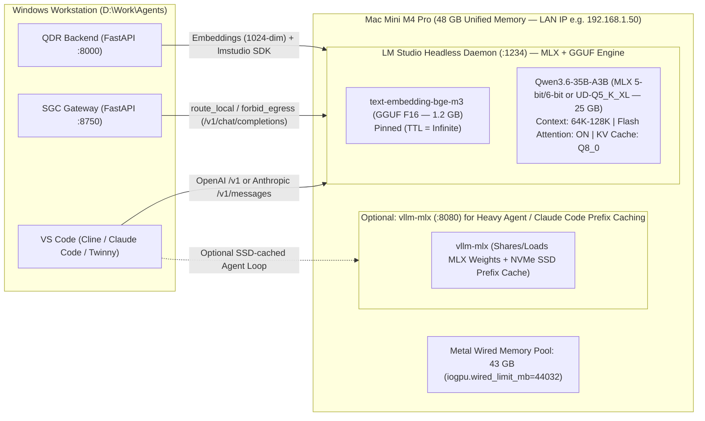

# Mac Mini M4 Pro (48 GB) — Hardware & Runtime Architecture

This document covers the hardware physics, unified memory tuning, thermal envelopes, and inference engine architecture for running a **Mac Mini M4 Pro with 48 GB Unified Memory** as a dedicated local AI server (`za-local`).

---

## 1. Hardware Specifications & Roofline Math

| Specification | Mac Mini M4 Pro (48 GB Config) | Architectural Impact on Local AI |
|---|---|---|
| **SoC** | Apple M4 Pro (12-core or 14-core CPU / 16-core or 20-core GPU) | Metal 3 GPU with hardware-accelerated ray tracing, dynamic caching, and AMX matrix coprocessors. |
| **Unified Memory Capacity** | **48 GB LPDDR5X** (`49,152 MB`) | Single contiguous address space shared across CPU, GPU, and Neural Engine. Zero PCIe copy overhead. |
| **Memory Bandwidth** | **273 GB/s** | **The #1 determinant of token generation speed.** Sets the physical ceiling on how many bytes of active weights can be read per second during autoregressive decode. |
| **Default Metal Wired Limit** | ~**36 GB** (`recommendedMaxWorkingSetSize` ≈ 75%) | macOS reserves ~25% for OS/CPU by default. Must be raised via `sysctl iogpu.wired_limit_mb` to unlock 42–44 GB for AI workloads. |
| **Power & Thermal Envelope** | ~15–25W idle · ~65–95W sustained AI load | Compact chassis requires active fan curve management (`Macs Fan Control`) during multi-hour batch ingestion or QDR document synthesis. |

### The Bandwidth Roofline Equation

During **Prompt Processing (Prefill)**, the GPU processes hundreds of tokens in parallel (compute-bound, achieving **350–650+ tok/s**).  
During **Token Generation (Decode)**, the GPU generates one token at a time and must read all *active* model weights + KV cache from Unified Memory for every single token (memory-bandwidth bound):

$$\text{Theoretical Max Decode (tok/s)} \approx \frac{\text{Memory Bandwidth (273 GB/s)} \times \eta_{\text{utilization}}}{\text{Active Weight Footprint (GB)} + \text{Active KV Cache Read (GB)}}$$

where $\eta_{\text{utilization}} \approx 0.72 \text{ to } 0.85$ on Apple Silicon (higher in **MLX**, slightly lower in **GGUF/Metal**).

| Model Architecture | Total Weights in RAM | Active Weights Read / Token | Real-World Decode on M4 Pro (273 GB/s) | Verdict |
|---|---|---|---|---|
| **Dense 70B** (`Q4_K_M`) | ~40.0 GB | ~40.0 GB | **~5.2 – 6.0 tok/s** | Too slow for interactive agent loops or QDR mediated turns. |
| **Dense 32B** (`Q4_K_M`) | ~19.5 GB | ~19.5 GB | **~11.0 – 13.5 tok/s** | Usable for single-shot tasks, sluggish on 7-call mediated turns. |
| **Dense 27B** (`Qwen3.5-27B Q6_K / Q8_0`) | ~22.0 – 28.5 GB | ~22.0 – 28.5 GB | **~13.5 – 18.0 tok/s** | Great quality/stability for single-pass document synthesis. |
| **Sparse MoE 35B-A3B** (`Qwen3.6-35B-A3B` **4-bit / 5-bit / 6-bit**) | **~21.0 – 28.0 GB** | **~1.8 – 2.5 GB** *(3B active!)* | **45.0 – 65.0 tok/s** | **The Sweet Spot:** 35B+ frontier intelligence at 3B-class speed. |
| **Dense 8B–9B** (`Qwen3.5-9B Q8_0`) | ~9.5 GB | ~9.5 GB | **~24.0 – 30.0 tok/s** | Slower *and* less capable than `Qwen3.6-35B-A3B` MoE! |

> [!IMPORTANT]
> **Counter-Intuitive Fact:** On a 48 GB Mac Mini Pro, **`Qwen3.6-35B-A3B` (35B parameters) runs roughly 2× faster in tokens/sec than `Qwen3.5-9B` (9B dense parameters)**—because 3B active parameters require reading less memory per token than a 9B dense model, while drawing from a 35B-parameter knowledge base!

---

## 2. Unlocking the Full 48 GB Unified Memory (`iogpu.wired_limit_mb`)

By default on macOS Sequoia / Tahoe, the kernel caps Metal's wired memory allocation at ~75% of physical RAM (~36 GB). When you load a 26 GB model + a 1.2 GB `bge-m3` embedding model + a 128K context window + a 3B autocomplete model, hitting the 36 GB Metal wall causes `kIOGPUCommandBufferCallbackErrorOutOfMemory` or silently falls back to CPU/swap.

### Recommended Memory Allocation Budget (48 GB = `49,152 MB`)

| Memory Slice | Allocation | Purpose |
|---|---|---|
| **macOS Kernel, WindowServer & Headless Daemons** | **5.0 – 6.0 GB** | Keeps macOS rock-solid without swap thrashing or kernel panics. |
| **Metal Wired GPU Pool (`iogpu.wired_limit_mb`)** | **42.0 GB (`43008 MB`)** *(Desktop)*<br>**43.0 GB (`44032 MB`)** *(Headless)* | Dedicated to LLM weights, KV caches, vision encoder, and `bge-m3` embeddings. |

### Commands to Inspect & Apply
```bash
# 1. Check current wired limit (0 = macOS default ~75%)
sysctl iogpu.wired_limit_mb

# 2. Set safe 42 GB (43,008 MB) limit immediately (no reboot required)
sudo sysctl iogpu.wired_limit_mb=43008

# 3. For a dedicated headless inference appliance, 43 GB (44,032 MB) is safe:
sudo sysctl iogpu.wired_limit_mb=44032
```
*(See [`scripts/macos/configure_vram_limit.sh`](file:///d:/Work/Agents/int-local-ai/scripts/macos/configure_vram_limit.sh) for the permanent `/Library/LaunchDaemons/com.localai.vramlimit.plist` installer so this persists across reboots).*

---

## 3. Inference Server Comparison & Dual-Engine Strategy

As highlighted in **Video 2 (`IRyiP_U7RuA` at `10:59` — "The Free Fix: Change Your Inference Server")**, the software runtime you choose on Apple Silicon makes a massive difference in speed, prefix caching, and compatibility with your existing codebase.

### Comparing the 4 Runtimes on macOS Apple Silicon

| Feature / Metric | **`vllm-mlx`** *(Native MLX)* | **`llama-server`** *(Direct `llama.cpp`)* | **`LM Studio`** *(GUI + `lms` daemon)* | **`Ollama`** *(Go wrapper over `llama.cpp`)* |
|---|---|---|---|---|
| **Backend Tensor Engine** | Apple **MLX** (`mlx-lm` / `mlx-vlm`) | `llama.cpp` (Metal GGUF) | Supports **both** MLX & `llama.cpp` GGUF | `llama.cpp` (GGUF) |
| **`Qwen3.6-35B-A3B` Decode Speed** | **50 – 65 tok/s** (Fastest) | **40 – 52 tok/s** | **48 – 62 tok/s** (with MLX engine) | **38 – 48 tok/s** |
| **Trie / Paged Prefix Caching** | **Yes** (RAM + `--ssd-cache-dir` NVMe spill) | **Yes** (`--cache-reuse 256` + slot save) | **Yes** (Prompt caching enabled by default) | Partial (Single-slot shift; weak under multi-agent concurrency) |
| **Anthropic `/v1/messages` API** | **Yes (Native)** — works directly with Claude Code | No (`/v1/chat/completions` only) | No (`/v1/chat/completions` + native SDK) | Recent beta support |
| **QDR `lmstudio` Python SDK Compat** | Via OpenAI `/v1` HTTP | Via OpenAI `/v1` HTTP | **100% Native** (`lmstudio` websocket + `/v1` HTTP) | Via QDR's `ollama` provider branch |
| **Simultaneous `bge-m3` Embedding** | Separate port/process | Separate port/process | **Built-in multi-model hosting** on port `1234` | Built-in multi-model hosting on port `11434` |

### Recommended Dual-Service Topology on the Mac Mini Pro 48 GB

Because **QDR** (`D:\Work\Agents\iOCO-vodacom-qdr`) has deeply integrated health checks, auto-recovery ladders (`services/lmstudio_control.py`), and progress callbacks via the `lmstudio` SDK on port `1234`, while **SGC** (`guardrails/upstream/local.py`) and **Claude Code / Cline** benefit maximally from **`vllm-mlx`** (with SSD-backed prefix caching and native `/v1/messages` + `/v1/chat/completions`), we recommend running **two lightweight co-resident services** or **LM Studio configured with its MLX backend**:



#### Why This Topology Works Seamlessly:
1. **Zero Code Changes Required in QDR to Start:**
   * LM Studio on macOS natively includes **Apple's MLX runtime engine** alongside `llama.cpp`!
   * When you load `mlx-community/Qwen3.6-35B-A3B-6bit` (or `unsloth/Qwen3.6-35B-A3B-UD-Q5_K_XL-GGUF`) inside LM Studio on the Mac Mini alongside `text-embedding-bge-m3`, QDR's existing `LMSTUDIO_BASE_URL=http://<mac-mini-ip>:1234/v1` works immediately.
   * Better yet, in LM Studio Server settings on the Mac Mini:
     * **Disable Auto-Evict / Idle TTL** for `text-embedding-bge-m3` (`lms load text-embedding-bge-m3 --ttl 0`) so QDR never hits the 1-hour idle unload bug documented in `services/lmstudio_control.py`!
     * **No Vulkan `ErrorDeviceLost` crashes:** QDR's `llm_provider.py` currently caps embedding batch size at `10` because Windows Vulkan drivers crashed with `ErrorDeviceLost`. On the Mac Mini's Metal backend, unified memory never suffers Vulkan TDR timeouts—you can safely raise QDR's local embedding batch size from `10` to `64` or `128`, speeding up QDR ingestion by **4–6×**!
2. **Maximum Multi-Turn Agent Speed via `vllm-mlx` (When Running Coding Agents or SGC):**
   * When running intensive multi-turn sessions (e.g., Claude Code, Cline on DIDS, or QDR's 7-call Mediated Conversation pipeline via OpenAI-compatible HTTP), `vllm-mlx` adds **trie-based prefix caching with SSD spill (`--ssd-cache-dir`)**, cutting Time-To-First-Token (TTFT) on repeated 20,000-token prompts from ~35 seconds down to **< 1.5 seconds**.

---

## 4. Thermal, Power, and Network Optimization on Mac Mini M4 Pro

1. **Prevent Sleep & App Nap (Headless Server Posture):**
   ```bash
   sudo pmset -a sleep 0 disksleep 0 displaysleep 15 womp 1 autorestart 1
   ```
2. **Prevent Thermal Throttling on Sustained Batch Workloads:**
   * As noted in Video 2, the compact Mac Mini chassis prioritizes silence by default, allowing internal SoC temperatures to hit 95–100°C before ramping the fan, which can throttle GPU clocks by 15–20% after 15 minutes of continuous batching.
   * Install **`Macs Fan Control`** (or `smcFanControl`) and set a custom sensor-based curve tied to **GPU Cluster / SoC Average Temp**: start ramping at **65°C** and reach max RPM at **85°C**. The fan remains whisper-quiet at idle and completely prevents thermal throttling during QDR subsystem synthesis runs.
3. **Use Gigabit / 10Gb Ethernet & IPv4 Explicit Addressing:**
   * Connect the Mac Mini via wired Ethernet (not Wi-Fi) to eliminate 5–20ms jitter on streaming SSE tokens.
   * Assign a static DHCP reservation on your router (e.g., `192.168.1.50`) or use Tailscale with MagicDNS.
   * Just as documented in QDR's `config.py` (`127.0.0.1` vs `localhost` IPv6 `::1` +2s hang), always configure `LMSTUDIO_BASE_URL` and SGC's `local_route` using the **explicit IPv4 address** (e.g., `http://192.168.1.50:1234/v1`).

