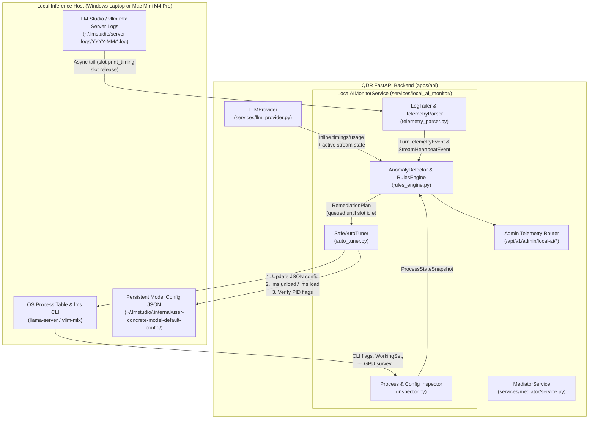

# Operational Local-AI Telemetry Monitoring & Self-Tuning Architecture for QDR

- **Date:** 2026-11-03
- **Target System:** QDR (`D:\Work\Agents\iOCO-vodacom-qdr`)
- **Reference Playbook Repo:** `d:\Work\Agents\int-local-ai` (`branch: dev-v1.2`)
- **Companion Specification:** [`2026-11-02-local-ai-prefill-and-moe-optimization-design.md`](file:///D:/Work/Agents/iOCO-vodacom-qdr/2026-11-02-local-ai-prefill-and-moe-optimization-design.md)
- **Target Environments:**
  - **Windows Laptop Staging:** `ASUS ExpertBook B1503CVA` (Intel i7-1355U, 64 GB DDR5, Intel Iris Xe Vulkan `31.80 GiB` shared VRAM, LM Studio `vulkan-avx2@2.57.0`, model `qwen3-coder-30b-a3b-instruct_pruned_reap-15b-a3b`)
  - **macOS Production Appliance:** **Apple Mac Mini M4 Pro (64 GB Unified Memory, 273 GB/s bandwidth, 56 GB Metal wired limit)** running `vllm-mlx` (`:8080`) and LM Studio MLX / `llama-server` (`:1234`) with `Qwen3.6-35B-A3B` (`8-bit` / `6-bit`)

---

## 1. Executive Summary & Purpose

During live testing of sparse Mixture-of-Experts (MoE) inference with QDR, we conducted an end-to-end **live telemetry monitoring, root-cause diagnosis, and non-disruptive parameter auto-tuning loop** against LM Studio's underlying `llama-server` engine.

By passively tailing LM Studio's verbose server logs, cross-referencing OS-level process command-line flags, and inspecting LM Studio's internal persistent configuration files, we:
1. Detected and resolved a silent Vulkan UUID discovery regression that had forced `GPU Offload = 0` (`1.7 GB` RAM usage instead of `9.17 GB` GPU offload).
2. Verified live multi-turn KV prefix caching across a 6-turn QDR test run (`609` → `6,659` tokens), proving that **99.4% of prompt tokens (`3,702` of `3,724` tokens)** were reused from cache and reducing **Prefill (TTFT) to `2.64s–4.29s` (`0.39%` of turn time)**.
3. Diagnosed why long-context token generation (`eval time`) degraded by **47%** (`5.71 tok/s` → `3.02 tok/s`) as context reached `6,659` tokens while `task 3484` was actively streaming.
4. Waited passively until `llama-server` emitted `slot release` (so the running query was never interrupted), then programmatically injected optimized parameters (`V Cache = Q8_0`, `Physical Batch Size = 2048`, `CPU Threads = 8`, `Parallel = 1`) into LM Studio's internal JSON configuration store, stopped competing background daemons (`ollama`), reloaded the model via the `lms` CLI, and verified the new OS process flags.

This document summarizes **how we performed that monitoring and tuning** and provides a **complete architectural specification** for implementing this exact capability inside QDR as an automated **`LocalAIMonitorService`**.

---

## 2. Chronological Summary of Activity: How We Monitored Logs & Adjusted Parameters

### Phase 1: Diagnosing Silent Hardware / Runtime Regressions (`1.7 GB` GPU Memory Issue)

#### What Happened
When the `9.75 GB` MoE model (`qwen3-coder-30b-a3b-instruct_pruned_reap-15b-a3b`) was initially loaded in LM Studio, system memory only rose by **`1.7 GB`** (because `mmap()` mapped the GGUF file lazily from disk) and the LM Studio UI showed:
- `All GPUs are currently disabled. Enable at least one to offload` (`GPU Offload = 0`)
- Trying to enable Vulkan threw: `llama-server Vulkan runtime supports UUID device selection, but the Vulkan survey did not provide device UUIDs.`
- Trying to enable `V Cache Quantization = Q8_0` threw: `V Cache Quantization requires flash attention to be enabled.`

#### How We Diagnosed & Fixed It
1. **Queried the LM Studio CLI Runtime Engine (`lms runtime`):**
   ```powershell
   C:\Users\mikem\.lmstudio\bin\lms.exe runtime ls
   C:\Users\mikem\.lmstudio\bin\lms.exe runtime survey
   ```
2. **Root Cause Identified:**
   - LM Studio had two Vulkan backends installed: `llama.cpp-win-x86_64-vulkan-avx2@2.60.0` (selected) and `2.57.0`, plus a CPU-only backend `llama.cpp-win-x86_64-avx2@2.28.2`.
   - Version `2.60.0` introduced mandatory Vulkan UUID device matching that failed on the laptop's Intel Iris Xe driver, causing LM Studio to disable all GPUs and fall back to `avx2@2.28.2` (CPU-only).
   - Because CPU-only `llama.cpp` does not support quantized V-cache kernels even when `--flash-attn` is requested, loading failed whenever `V Cache Quantization` was checked.
3. **Programmatic Remediation:**
   - We switched the active runtime to `2.57.0` via CLI:
     ```powershell
     C:\Users\mikem\.lmstudio\bin\lms.exe runtime select llama.cpp-win-x86_64-vulkan-avx2@2.57.0
     ```
   - We immediately ran `lms runtime survey`, confirming detection of **`Intel(R) Iris(R) Xe Graphics (Vulkan, Integrated) — 31.80 GiB`**, and reloaded the model with `--gpu max` (`9.08 GiB` offloaded into shared GPU memory).

---

### Phase 2: Ground-Truth Process Inspection vs. UI State

#### Why Process Inspection Is Essential
We discovered that when switching runtimes or when a second instance of a model is loaded (`model-id:2`), LM Studio can silently revert individual sliders (such as `Physical Batch Size` reverting from `2048` to `512`, or `CPU Thread Pool Size` reverting from `8` to `5`).

#### How We Inspected Ground-Truth Parameters
Instead of relying on UI state, we queried the OS process table for `llama-server.exe` to extract its exact command line and memory footprint (`WorkingSet64`):

```powershell
Get-CimInstance Win32_Process -Filter "Name = 'llama-server.exe'" |
  Select-Object ProcessId, CommandLine
```

During the user's test run (`PID 16696`, `WorkingSet = 9.17 GB`), this revealed the exact ground-truth flags:
```text
C:\Users\mikem\.lmstudio\extensions\backends\llama.cpp-win-x86_64-vulkan-avx2-2.57.0\llama-server.exe
  --model D:\LMStudioModels\12bitmisfit\Qwen3-Coder-30B-A3B-Instruct_Pruned_REAP-15B-A3B-GGUF\Qwen3-Coder-30B-A3B-Instruct-Pruned-Q4_K_M.gguf
  --ctx-size 65536
  --n-gpu-layers 999999
  --n-cpu-moe 0
  --main-gpu 0
  --ctx-checkpoints 32
  --batch-size 2048
  --ubatch-size 512
  --threads 5
  --parallel 1
  --cache-type-k q8_0
  --cache-type-v f16
  --flash-attn on
  --kv-offload
  --kv-unified
  --load-mode mmap+mlock
```

This single inspection proved:
1. **The critical prefill settings were active:** `--n-gpu-layers 999999`, `--parallel 1`, `--ctx-checkpoints 32`, `--flash-attn on`, `--kv-offload`, `--kv-unified`, and `--cache-type-k q8_0`.
2. **Three secondary parameters needed tuning after the test finished:**
   - `--ubatch-size` was `512` instead of `2048`.
   - `--threads` was `5` instead of `8`.
   - `--cache-type-v` was `f16` (unquantized) instead of `q8_0`.
3. **Competing Background Processes:** Inspecting `Get-Process` also revealed `ollama.exe` (`PID 21324`) and two `python3.13` processes consuming CPU time and shared DDR5 memory bandwidth in the background.

---

### Phase 3: Passive Real-Time Log Monitoring (`~/.lmstudio/server-logs/`)

#### Where LM Studio Writes Server Logs
- **Log Directory:** `C:\Users\mikem\.lmstudio\server-logs\YYYY-MM\` (or `~/.lmstudio/server-logs/YYYY-MM/` on macOS).
- **Log Naming Convention:** `YYYY-MM-DD.N.log` (e.g., [`2026-11-02.2.log`](file:///C:/Users/mikem/.lmstudio/server-logs/2026-11/2026-11-02.2.log)), where `N` increments when the server restarts.
- **State Pointer File:** [`C:\Users\mikem\.lmstudio\.internal\server-logs-state.json`](file:///C:/Users/mikem/.lmstudio/.internal/server-logs-state.json).

#### Exact Log Signatures We Monitored
When `--verbosity 3` (Verbose Server Logs) is active, `llama-server` emits three classes of diagnostic lines for every request on `slot 0`:

1. **Streaming Progress Heartbeat (emitted every ~3 seconds during token generation):**
   ```text
   [2026-11-02 19:32:51][DEBUG] 144.05.779.649 I slot print_timing: id  0 | task 3484 | n_gen =   2338, tg =   3.15 t/s, tg_3s =   2.64 t/s
   ```
   - `task 3484`: Unique internal task ID for the request.
   - `n_gen`: Number of output tokens generated so far.
   - `tg`: Cumulative average token generation speed (`tok/s`) since decode started.
   - `tg_3s`: Instantaneous 3-second rolling token generation speed (`tok/s`).

2. **Turn Completion Timing Summary (emitted immediately when generation finishes):**
   ```text
   [2026-11-02 19:36:41][DEBUG] 147.56.431.957 I slot print_timing: id  0 | task 3484 | prompt eval time =    3811.90 ms /    22 tokens (  173.27 ms per token,     5.77 tokens per second)
   147.56.432.261 I slot print_timing: id  0 | task 3484 |        eval time =  972188.60 ms /  2935 tokens (  331.35 ms per token,     3.02 tokens per second)
   147.56.432.737 I slot print_timing: id  0 | task 3484 |       total time =  976000.50 ms /  2957 tokens
   147.56.432.760 I slot print_timing: id  0 | task 3484 |    graphs reused =       6370
   147.56.432.763 I slot print_timing: id  0 | task 3484 |   graph reallocs =          0    /     0        (same size) / (changed size)
   ```

3. **Slot Release & Total Context Footprint (emitted right after timing summary):**
   ```text
   [2026-11-02 19:36:41][DEBUG] 147.56.433.583 I slot      release: id  0 | task 3484 | stop processing: n_tokens = 6659, truncated = 0
   ```

#### How We Computed Prefix Cache Efficiency from Those 3 Lines
From `slot print_timing` and `slot release`, we derived the complete per-turn KV cache accounting using exact arithmetic:
- $\text{Total Context Tokens after Turn} = \texttt{n\_tokens}$ (from `slot release`, e.g., `6659`)
- $\text{Generated Output Tokens} = \texttt{n\_eval}$ (from `eval time = ... / 2935 tokens`)
- $\text{New Delta Prompt Tokens Evaluated} = \texttt{n\_prompt\_eval}$ (from `prompt eval time = ... / 22 tokens`)
- $\text{Total Input Prompt Tokens} = \texttt{n\_tokens} - \texttt{n\_eval} = 6659 - 2935 = 3724\text{ tokens}$
- $\text{Cached Prefix Tokens Reused} = \text{Total Input Prompt Tokens} - \texttt{n\_prompt\_eval} = 3724 - 22 = 3702\text{ tokens}$
- $\text{Prefix Cache Hit Rate} = \frac{3702}{3724} = \mathbf{99.41\%}$

#### How We Watched Passively Without Disrupting the Active Run
When the user asked us to watch `task 3484` until completion:
- We **never** modified files or reloaded the model while `slot print_timing` showed `task 3484` in progress.
- Instead, we set a non-blocking 60-second scheduled check (`Select-String` on the tail of `2026-11-02.2.log`) watching specifically for `slot release: id 0 | task 3484`.
- As soon as `slot release` appeared at `19:36:41`, we cancelled the timer and presented the full 6-turn table:

| Turn / Task ID | Total Context (`n_tokens`) | Input Prompt Tokens | Cached Prefix Reused | **New Delta Evaluated** | **Prefill (`prompt eval`)** | Generated (`eval`) | Decode Time | Decode Speed (`tok/s`) |
| :--- | :---: | :---: | :---: | :---: | :---: | :---: | :---: | :---: |
| **Turn 1 (`task 350`)** | `609` | `475` | `454` (`95.6%`) | **`21`** | **`4.11 s`** | `134` | `26.9 s` | `4.94 tok/s` |
| **Turn 2 (`task 485`)** | `825` | `640` | `608` (`95.0%`) | **`32`** | **`4.29 s`** | `185` | `32.2 s` | **`5.71 tok/s`** |
| **Turn 3 (`task 671`)** | `911` | `846` | `824` (`97.4%`) | **`22`** | **`2.64 s`** | `65` | `11.3 s` | `5.66 tok/s` |
| **Turn 4 (`task 737`)** | `1,777` | `938` | `910` (`97.0%`) | **`28`** | **`3.50 s`** | `839` | `147.2 s` | `5.69 tok/s` |
| **Turn 5 (`task 1577`)** | `3,703` | `1,797` | `1,776` (`98.8%`) | **`21`** | **`2.84 s`** | `1,906` | `410.6 s` | `4.64 tok/s` |
| **Turn 6 (`task 3484`)** | **`6,659`** | **`3,724`** | **`3,702` (`99.4%`)** | **`22`** | **`3.81 s`** | **`2,935`** | **`972.2 s`** | **`3.02 tok/s`** |

---

### Phase 4: Programmatic Parameter Adjustment & Verification

Once `slot release` confirmed the model was idle, we automated the parameter upgrade without requiring manual UI clicks:

1. **Located LM Studio's Internal Per-Model Config Store:**
   - Path: `C:\Users\mikem\.lmstudio\.internal\user-concrete-model-default-config\<publisher>\<model-folder>\<gguf-filename>.json`
   - For our model: [`Qwen3-Coder-30B-A3B-Instruct-Pruned-Q4_K_M.gguf.json`](file:///C:/Users/mikem/.lmstudio/.internal/user-concrete-model-default-config/12bitmisfit/Qwen3-Coder-30B-A3B-Instruct_Pruned_REAP-15B-A3B-GGUF/Qwen3-Coder-30B-A3B-Instruct-Pruned-Q4_K_M.gguf.json)
2. **Extracted the Exact Internal Schema Keys from LM Studio's Main Bundle:**
   - By scanning `C:\Program Files\LM Studio\resources\app\.webpack\main\*.js` for `llm.load.llama.*`, we identified the exact configuration keys LM Studio uses when spawning `llama-server`:
     - `llm.load.contextLength` (`65536`)
     - `llm.load.llama.cpuThreadPoolSize` (`8`)
     - `llm.load.llama.evalBatchSize` (`2048`)
     - `llm.load.llama.physicalBatchSize` (`2048`)
     - `llm.load.numParallelSessions` (`1`)
     - `llm.load.llama.kCacheQuantizationType` (`{"checked": true, "value": "q8_0"}`)
     - `llm.load.llama.vCacheQuantizationType` (`{"checked": true, "value": "q8_0"}`)
     - `llm.load.llama.flashAttention` (`true`)
     - `llm.load.llama.acceleration.offloadRatio` (`1`)
3. **Wrote the Updated JSON Config & Reloaded Cleanly via CLI:**
   - Stopped background `ollama*` processes (`Stop-Process -Name "ollama*" -Force`).
   - Wrote the updated JSON to `Qwen3-Coder-30B-A3B-Instruct-Pruned-Q4_K_M.gguf.json`.
   - Executed `lms unload --all` followed by `lms load "qwen3-coder-30b-a3b-instruct_pruned_reap-15b-a3b" --gpu max --context-length 65536 --parallel 1 -y`.
4. **Verified the New OS Process (`PID 55312`):**
   - Confirmed via `Win32_Process` that `--ubatch-size 2048`, `--threads 8`, `--cache-type-k q8_0`, and `--cache-type-v q8_0` were all active on the new `llama-server.exe` process.

---

## 3. Blueprint for QDR: Operational Telemetry & Self-Tuning Subsystem (`LocalAIMonitorService`)

To build this capability directly into the **QDR operational system** (`D:\Work\Agents\iOCO-vodacom-qdr`), implement a lightweight, event-driven **`LocalAIMonitorService`** in `apps/api/services/local_ai_monitor/`.

### 3.1 System Architecture Diagram



---

### 3.2 Dual-Source Telemetry Collection (`telemetry_parser.py`)

QDR should collect telemetry from **two complementary sources** so it works both when QDR runs on the same machine as LM Studio and when QDR connects over the LAN to the Mac Mini M4 Pro:

#### Source A: Inline API Response Telemetry (Works Locally & Over LAN)
Both `llama-server` (LM Studio) and `vllm-mlx` return exact prefill and decode timings directly inside the HTTP response body (or the final SSE chunk when `stream_options={"include_usage": True}` is sent):
- **`llama-server` / LM Studio `timings` object in response JSON:**
  ```json
  {
    "timings": {
      "cache_n": 3702,
      "prompt_n": 22,
      "prompt_ms": 3811.9,
      "prompt_per_token_ms": 173.27,
      "prompt_per_second": 5.77,
      "predicted_n": 2935,
      "predicted_ms": 972188.6,
      "predicted_per_token_ms": 331.35,
      "predicted_per_second": 3.02
    }
  }
  ```
  - **Action in QDR [`llm_provider.py`](file:///D:/Work/Agents/iOCO-vodacom-qdr/apps/api/services/llm_provider.py):** Extract `response.model_extra.get("timings")` (in `generate_text`) and the final SSE chunk's `timings` / `usage` (in `_generate_stream_lmstudio`) and emit a `TurnTelemetryEvent` to `LocalAIMonitorService`.

#### Source B: Asynchronous Log File Tailer (Rich Slot, Graph & Rolling `tg_3s` Telemetry)
When QDR has filesystem access to `~/.lmstudio/server-logs/` (or `/var/log/vllm-mlx.log` on the Mac Mini):
1. Locate the newest `.log` file in `~/.lmstudio/server-logs/<YYYY-MM>/` sorted by `LastWriteTime`.
2. Tail new lines asynchronously (`asyncio` file watcher polling every `1.0s` from the last byte offset) and match three compiled regular expressions:

```python
import re
from dataclasses import dataclass

RE_STREAM_HEARTBEAT = re.compile(
    r"slot print_timing:\s+id\s+(?P<slot_id>\d+)\s+\|\s+task\s+(?P<task_id>\d+)\s+\|\s+"
    r"n_gen\s*=\s*(?P<n_gen>\d+),\s*tg\s*=\s*(?P<tg_avg>[\d.]+)\s*t/s,\s*tg_3s\s*=\s*(?P<tg_3s>[\d.]+)\s*t/s"
)

RE_PROMPT_EVAL = re.compile(
    r"slot print_timing:\s+id\s+(?P<slot_id>\d+)\s+\|\s+task\s+(?P<task_id>\d+)\s+\|\s+"
    r"prompt eval time\s*=\s*(?P<prompt_ms>[\d.]+)\s*ms\s*/\s*(?P<prompt_tokens>\d+)\s*tokens\s*"
    r"\(\s*(?P<ms_per_tok>[\d.]+)\s*ms per token,\s*(?P<prompt_tps>[\d.]+)\s*tokens per second\)"
)

RE_EVAL_TIME = re.compile(
    r"slot print_timing:\s+id\s+(?P<slot_id>\d+)\s+\|\s+task\s+(?P<task_id>\d+)\s+\|\s+"
    r"eval time\s*=\s*(?P<eval_ms>[\d.]+)\s*ms\s*/\s*(?P<eval_tokens>\d+)\s*tokens\s*"
    r"\(\s*(?P<ms_per_tok>[\d.]+)\s*ms per token,\s*(?P<eval_tps>[\d.]+)\s*tokens per second\)"
)

RE_GRAPH_REUSE = re.compile(
    r"slot print_timing:\s+id\s+(?P<slot_id>\d+)\s+\|\s+task\s+(?P<task_id>\d+)\s+\|\s+"
    r"graphs reused\s*=\s*(?P<graphs_reused>\d+)"
)

RE_GRAPH_REALLOC = re.compile(
    r"slot print_timing:\s+id\s+(?P<slot_id>\d+)\s+\|\s+task\s+(?P<task_id>\d+)\s+\|\s+"
    r"graph reallocs\s*=\s*(?P<realloc_same>\d+)\s*/\s*(?P<realloc_changed>\d+)"
)

RE_SLOT_RELEASE = re.compile(
    r"slot\s+release:\s+id\s+(?P<slot_id>\d+)\s+\|\s+task\s+(?P<task_id>\d+)\s+\|\s+"
    r"stop processing:\s+n_tokens\s*=\s*(?P<n_tokens>\d+),\s*truncated\s*=\s*(?P<truncated>\d+)"
)
```

---

### 3.3 Ground-Truth Process & Config Inspector (`inspector.py`)

`ProcessAndConfigInspector` queries the host OS (Windows or macOS) to verify the actual running flags of `llama-server` / `vllm-mlx`:

```python
from dataclasses import dataclass
from typing import Optional

@dataclass
class ServerProcessSnapshot:
    pid: int
    engine: str                   # "llama-server" | "vllm-mlx"
    model_path: str
    working_set_gb: float
    ctx_size: int
    n_gpu_layers: int
    n_cpu_moe: int
    ctx_checkpoints: int
    batch_size: int
    ubatch_size: int
    threads: int
    parallel_slots: int
    cache_type_k: str             # "f16" | "q8_0" | "q4_0"
    cache_type_v: str             # "f16" | "q8_0" | "q4_0"
    flash_attn: bool
    kv_offload: bool
    kv_unified: bool
    competing_daemons: list[str]  # e.g. ["ollama.exe (PID 21324)"]
```

- **Cross-Platform Discovery:**
  - **Windows:** Uses `psutil.process_iter(['pid', 'name', 'cmdline', 'memory_info'])` (or `Get-CimInstance Win32_Process`) to parse `llama-server.exe` arguments and detect competing `ollama.exe` processes.
  - **macOS (Mac Mini M4 Pro):** Uses `psutil` to inspect `llama-server` or `vllm-mlx` processes plus `sysctl iogpu.wired_limit_mb` to confirm the `57344 MB` (`56 GB`) Metal wired memory pool is active.

---

### 3.4 Operational Anomaly Detection & Auto-Tuning Rules Engine (`rules_engine.py`)

On every `StreamHeartbeatEvent` and `TurnTelemetryEvent`, `RulesEngine` evaluates **7 deterministic operational rules**:

| Rule ID | Condition Triggered | Root Cause | Automated Action (`SafeAutoTuner` or `MediatorService`) |
| :--- | :--- | :--- | :--- |
| **`R1_PREFIX_CACHE_MISS`** | Follow-up turn (`step > 1`) has `prefix_hit_ratio < 0.80` and `n_prompt_eval > 256` | Prompt prefix mutated early, or `--parallel > 1` caused round-robin slot miss | 1. Log exact divergence offset between `prev_prompt` and `curr_prompt`.<br>2. If `parallel_slots > 1` for single-tenant loop, queue reload with `numParallelSessions = 1` (or pin `id_slot: 0` in payload). |
| **`R2_GPU_OFFLOAD_ZERO`** | `n_gpu_layers == 0` or `working_set_gb < 0.4 * gguf_size_gb` | Vulkan/Metal runtime survey failure (e.g., `vulkan-avx2@2.60.0` UUID bug) | Run `lms runtime survey`; if UUID error detected, auto-select `vulkan-avx2@2.57.0` and reload with `--gpu max`. |
| **`R3_LONG_CTX_DECODE_DROP`** | `n_tokens > 3000` and `tg_3s < 0.65 * baseline_tg` while `cache_type_v == "f16"` | Unquantized `f16` Value cache saturating memory bandwidth at long context | Queue non-disruptive config update: set `llm.load.llama.vCacheQuantizationType = {"checked": true, "value": "q8_0"}` and `kCacheQuantizationType = "q8_0"`. |
| **`R4_SUBOPTIMAL_BATCH_THREADS`** | `ubatch_size < 1024` or `threads < optimal_threads` | LM Studio reset sliders after runtime switch or `:2` duplicate model load | Queue config update: set `llm.load.llama.physicalBatchSize = 2048`, `evalBatchSize = 2048`, `cpuThreadPoolSize = 8`. |
| **`R5_RUNAWAY_GENERATION`** | `n_gen > 1000` on an intermediate Curator/Reviewer step (or `n_gen > 2500` on final step) | Missing per-stage `max_tokens` cap or `<think>` mode unintentionally active | Immediately enforce `max_tokens` per Mediator stage (`600` Curator, `500` Reviewer, `1500` Presenter) and inject `"chat_template_kwargs": {"enable_thinking": False}`. |
| **`R6_COMPETING_DAEMON`** | `ollama` process detected running while `llama-server` / `vllm-mlx` is active | Background LLM server competing for unified/shared DDR5/LPDDR5X memory bandwidth | Stop idle `ollama` daemon or surface one-click remediation banner in QDR Admin UI. |
| **`R7_MODELS_POLL_FLOOD`** | `GET /v1/models` count `> 2` during an active `slot 0` generation | Uncached health/status checks interrupting `llama-server` HTTP thread | Enable 60-second in-memory TTL cache on `/v1/models` inside `LLMProvider` and suppress probes while `is_streaming == True`. |

---

### 3.5 Non-Disruptive State-Machine Auto-Tuner (`auto_tuner.py`)

The golden rule we followed in our live session must be enforced in code: **Never reload a model or mutate server state while a slot is actively processing a query.**

```python
import json
import subprocess
from pathlib import Path

class SafeAutoTuner:
    """Applies LM Studio / llama-server parameter optimizations only when all slots are idle."""

    def __init__(self, lms_bin: Path, lmstudio_home: Path):
        self.lms_bin = lms_bin
        self.lmstudio_home = lmstudio_home
        self.pending_overrides: dict = {}
        self.slot_busy: bool = False

    def queue_parameter_patch(self, model_rel_path: str, patch_fields: dict) -> None:
        """Queue parameter updates to be applied as soon as slot release is observed."""
        self.pending_overrides[model_rel_path] = {
            **self.pending_overrides.get(model_rel_path, {}),
            **patch_fields,
        }

    def on_slot_release(self, model_identifier: str, model_rel_path: str) -> bool:
        """Triggered when RE_SLOT_RELEASE is observed in the server log and no streams are active."""
        self.slot_busy = False
        if model_rel_path not in self.pending_overrides:
            return False

        patch = self.pending_overrides.pop(model_rel_path)
        self._update_lmstudio_model_json(model_rel_path, patch)
        self._reload_model_cleanly(model_identifier)
        return True

    def _update_lmstudio_model_json(self, model_rel_path: str, patch: dict) -> None:
        cfg_path = (
            self.lmstudio_home
            / ".internal"
            / "user-concrete-model-default-config"
            / f"{model_rel_path}.json"
        )
        cfg_path.parent.mkdir(parents=True, exist_ok=True)
        data = {"preset": "", "operation": {"fields": []}, "load": {"fields": []}}
        if cfg_path.exists():
            data = json.loads(cfg_path.read_text(encoding="utf-8"))

        fields_by_key = {f["key"]: f["value"] for f in data.get("load", {}).get("fields", [])}
        fields_by_key.update(patch)
        data["load"]["fields"] = [{"key": k, "value": v} for k, v in fields_by_key.items()]
        cfg_path.write_text(json.dumps(data, indent=2), encoding="utf-8")

    def _reload_model_cleanly(self, model_identifier: str, context_length: int = 65536) -> None:
        base_id = model_identifier.split(":")[0]  # Strip duplicate ':2' suffix if present
        subprocess.run([str(self.lms_bin), "unload", "--all"], check=True)
        subprocess.run(
            [
                str(self.lms_bin),
                "load",
                base_id,
                "--gpu",
                "max",
                "--context-length",
                str(context_length),
                "--parallel",
                "1",
                "--identifier",
                base_id,
                "-y",
            ],
            check=True,
        )
```

---

### 3.6 QDR Admin Telemetry Endpoint & UI Integration

Add a lightweight router at `apps/api/routers/local_ai_telemetry.py` with two endpoints:

1. **`GET /api/v1/admin/local-ai/telemetry`**
   Returns:
   - **`process_snapshot`:** Active PID, engine (`llama-server` / `vllm-mlx`), GPU offload status, active CLI flags (`--ubatch-size`, `--cache-type-k`, `--cache-type-v`, `--parallel`, `--ctx-checkpoints`).
   - **`live_slot_status`:** Whether Slot 0 is currently `IDLE`, `PREFILLING`, or `DECODING` (`n_gen`, `tg_avg`, `tg_3s`).
   - **`recent_turns`:** Table of the last 20 turns with `n_tokens`, `cached_prefix_tokens`, `delta_eval_tokens`, **`prefix_hit_pct`**, **`prefill_seconds`**, `generated_tokens`, `decode_tps`, and `graph_reallocs`.
   - **`anomalies`:** Any active warnings from Rules `R1`–`R7` and whether a queued auto-tune patch is waiting for `slot release`.

2. **`POST /api/v1/admin/local-ai/autotune`**
   - Allows the QDR operator (or the QDR agent automatically) to apply the optimal profile (`V Cache = Q8_0`, `K Cache = Q8_0`, `Physical Batch Size = 2048`, `Eval Batch Size = 2048`, `Parallel = 1`, `Context Checkpoints = 32`) immediately if idle, or queue it for the exact millisecond the current generation finishes.

---

## 4. Implementation Checklist for the QDR Agent

When picking up this file alongside [`2026-11-02-local-ai-prefill-and-moe-optimization-design.md`](file:///D:/Work/Agents/iOCO-vodacom-qdr/2026-11-02-local-ai-prefill-and-moe-optimization-design.md), implement in the following order:

1. **Step 1 — Prompt Prefix & Output Budget Fixes (`2026-11-02` Spec Fixes 1–7):**
   - Stabilize `known_evidence()` sort order and Curator/Reviewer/Presenter prompt prefixes.
   - Add per-stage `max_tokens` guardrails (`600` / `500` / `1500`) and `"enable_thinking": False` default (`Fix 6`).
   - Add a 60-second TTL cache on `/v1/models` health discovery and suppress polling while a stream is active (`Fix 7`).
2. **Step 2 — Inline + Log Telemetry Parser (`apps/api/services/local_ai_monitor/telemetry_parser.py`):**
   - Capture `timings` from LM Studio HTTP/SSE responses AND tail `~/.lmstudio/server-logs/` when running on the local host.
   - Compute and log `prefix_hit_pct`, `prefill_ms`, and `decode_tps` after every QDR turn.
3. **Step 3 — Process Inspector & Safe Auto-Tuner (`inspector.py`, `rules_engine.py`, `auto_tuner.py`):**
   - Inspect `llama-server` / `vllm-mlx` CLI flags on startup and after model switches.
   - Queue and apply non-disruptive parameter patches on `slot release` whenever suboptimal flags (`--cache-type-v f16`, `--ubatch-size 512`, `--parallel > 1`, or `--n-gpu-layers 0`) are detected.
