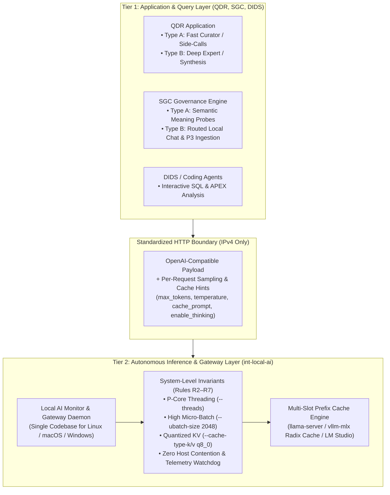
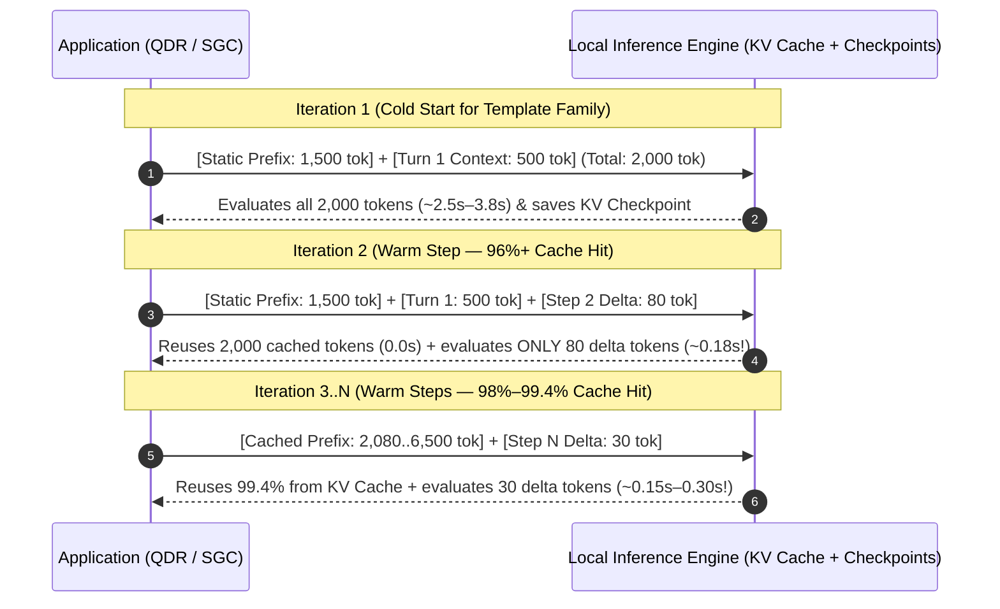

# Detailed Design: Two-Tier Local Inference Architecture & Multi-Workload Prefill Optimization

> **Document ID:** `10-two-tier-inference-gateway-and-workload-design`  
> **Companion Specs:**  
> - [`11-qdr-query-structuring-and-workload-specification.md`](file:///d:/Work/Agents/int-local-ai/docs/11-qdr-query-structuring-and-workload-specification.md)  
> - [`12-sgc-query-structuring-and-workload-specification.md`](file:///d:/Work/Agents/int-local-ai/docs/12-sgc-query-structuring-and-workload-specification.md)  
> **Related Baseline:** [`09-generic-prefill-optimization-and-autotuning-framework.md`](file:///d:/Work/Agents/int-local-ai/docs/09-generic-prefill-optimization-and-autotuning-framework.md)  
> **Target Systems:** `int-local-ai` (Central Gateway / Daemon), `iOCO-vodacom-qdr` (QDR), `int-standards-guardrails-compliance` (SGC), `iOCO-vodacom-dids-work` (DIDS), and Linux Test Harnesses  
> **Status:** Approved Architectural Design  
> **Date:** 2026-11-06  

---

## 1. Executive Summary & The Core Design Principle

### 1.1 The Bottom-Line Objective
Across local LLM deployments, **prompt prefill (Time-To-First-Token / TTFT) accounts for 85% to 95% of perceived latency** whenever the KV prefix cache is missed. The primary goal of this architecture is **not** to micro-tune C++ engine flags on every individual query, nor to force every cold query to be instantaneous, but rather to **eliminate the prefill delay on the vast majority (80%–95%+) of operational iterations** while maintaining a single, clean, zero-duplication codebase.

### 1.2 Why Application-Embedded Engine Tuning Is Rejected
In an earlier iteration ([`08-qdr-telemetry-monitoring-and-autotuning-design.md`](file:///d:/Work/Agents/int-local-ai/docs/08-qdr-telemetry-monitoring-and-autotuning-design.md)), we explored embedding log tailing, OS process inspection, and parameter auto-tuning (`LocalAIMonitorService`) directly inside QDR. Upon architectural review across the broader multi-project estate (`QDR`, `SGC`, `DIDS`, and upcoming Linux test benches), embedding infrastructure tuning inside application repositories introduces three critical liabilities:
1. **Leaky Abstraction:** Domain applications (`QDR` for code/artefact intelligence, `SGC` for compliance/guardrails) should never manage GPU driver flags (`--ubatch-size`, `--cache-type-v q8_0`), physical CPU core masks, or OS process termination (`pkill ollama`).
2. **Codebase Duplication:** Maintaining engine-tuning logic inside QDR and simultaneously maintaining a generic version for SGC, DIDS, and Linux servers creates two diverging codebases.
3. **Destructive Engine Reloads Across Workloads:** If two applications or two query types attempt to re-tune engine-level parameters on the fly, reloading the model **purges 100% of the in-memory KV cache** and stalls all callers for 10–30 seconds.

### 1.3 The Solution: Strict Two-Tier Separation of Concerns
We decouple the system into two strictly separated tiers that communicate exclusively over the standard OpenAI-compatible HTTP contract (`POST /v1/chat/completions` and `POST /v1/embeddings`):



---

## 2. How Differing Workloads Are Handled Without Engine Reconfiguration

A central question in multi-workload local AI is:
> *"When the LLM receives very different query types—such as QDR's fast JSON Curator steps vs. QDR's long Expert syntheses, or SGC's 3-second YES/NO semantic probes vs. full chat completions—do we change the tuning parameters per query, or set them once at the system level?"*

### 2.1 The Architectural Answer: Constant Infrastructure, Dynamic Request Payloads

**System-level engine parameters are set ONCE according to the 7 Rules and remain constant across all query types.** You never alter C++ runtime flags (`threads`, `ubatch`, `kv-cache dtype`) when switching between query types. Instead, workload adaptation happens dynamically at two lightweight levels:
1. **Payload-Level Sampling & Budget Controls** (passed per HTTP request in Tier 1).
2. **Prefix-Slot Routing & Monotonic Prompt Growth** (handled automatically by the KV cache in Tier 2).

### 2.2 Separation Matrix: System Invariants vs. Per-Query Controls

| Parameter / Mechanism | Tier | Changes Per Query? | Value / Policy | Why It Covers All Workloads Simultaneously |
| :--- | :---: | :---: | :--- | :--- |
| **Physical Batch (`--ubatch-size`)** | **Tier 2 (System)** | **NO (Constant)** | `2048` | Saturates SIMD/GPU matrix pipelines during cold prefill and chunk ingestion without penalizing short 20-token delta turns. |
| **Logical Batch (`--batch-size`)** | **Tier 2 (System)** | **NO (Constant)** | `2048` (or `4096` on M4 Pro) | Allows large prompts to be ingested in minimal passes while small prompts use only the exact token count needed. |
| **CPU Threads (`--threads`)** | **Tier 2 (System)** | **NO (Constant)** | `$N_{\text{P-Cores}}$` (e.g., `8` or `10`) | Matches physical performance cores; optimal for both short and long prefill passes. |
| **KV Cache Quantization (`--cache-type-k/v`)** | **Tier 2 (System)** | **NO (Constant)** | `q8_0` / `q8_0` | Halves KV memory bandwidth and doubles effective context capacity for both short lookups and 64K+ synthesis tasks. |
| **Checkpoints / Prefix Radix Cache** | **Tier 2 (System)** | **NO (Constant)** | `--ctx-checkpoints 32` / `--enable-prefix-cache` | Allows the engine to store multiple prefix snapshots across turns and distinct templates without recomputing from token `0`. |
| **Prefix Layout (Rule 1)** | **Tier 1 (Query)** | **Template-Fixed** | Static header at tokens `0..K`; append-only history; dynamic delta at tail | Guarantees that 80%–95% of turns skip prefill on the first `K` tokens. |
| **Reasoning Toggle (`enable_thinking`)** | **Tier 1 (Payload)** | **YES (Per Call)** | `false` for JSON/probes; `true` (optional) for deep analysis | Saves 5–15 seconds on structured JSON/classification calls without reloading the model. |
| **Output Budget (`max_tokens`)** | **Tier 1 (Payload)** | **YES (Per Call)** | `3` (SGC probe) · `600` (Curator) · `1500–4096` (Expert) | Prevents runaway 2,900-token essays on intermediate steps while allowing full depth on final answers. |
| **Sampling (`temperature`, `top_p`)** | **Tier 1 (Payload)** | **YES (Per Call)** | `0.0–0.2` (JSON/SQL/Probes) · `0.3–0.6` (Prose) | Adjusts determinism per task inside the standard JSON request body. |

---

## 3. How Prefix Cache Preservation Works Across Heterogeneous Workloads

To achieve a **90%+ prefill reduction on the majority of iterations** when multiple query types hit the same local inference server, we align **Prompt Families** with **KV Cache Slots / Checkpoints**.

### 3.1 Anatomy of Multi-Turn & Multi-Step Prefill Reduction



### 3.2 Handling Interleaved Workloads (Curator vs. Expert vs. SGC Probes)

When different query types are interleaved (for example, QDR runs 5 Curator steps, then 1 Expert draft, then 1 Curator review; or SGC fires a semantic detector probe in the middle of a chat session), two mechanisms prevent cache thrashing:

1. **Prefix Checkpoints (`--ctx-checkpoints 32` in `llama-server` / LM Studio) & Radix Attention (`--enable-prefix-cache` in `vllm-mlx`):**
   - Unlike older `llama.cpp` builds that held only a single linear token buffer per slot, modern `llama-server` (`--ctx-checkpoints 32` with `--kv-unified`) and `vllm-mlx` (Paged/Radix Attention) store **prefix checkpoints / tree nodes** in the unified KV pool.
   - When QDR switches from **Curator Step 5** (Prefix Family A) to **Expert Draft** (Prefix Family B) and then back to **Curator Review** (Prefix Family A), the engine restores the Curator's KV checkpoint rather than recomputing all 4,000 Curator tokens from scratch.
2. **Dedicated Slot Isolation on 64 GB Hardware (`--parallel 2` on Mac Mini M4 Pro):**
   - On the 64 GB Mac Mini M4 Pro (and 64 GB Linux servers), configuring `--parallel 2` with `--kv-unified` and `--cache-type-k q8_0 --cache-type-v q8_0` provides two concurrent execution slots sharing a unified 8-bit KV pool—allowing **Slot 0** to hold the active multi-step Curator chain while **Slot 1** services Expert drafts or SGC semantic probes without evicting Slot 0.
   - On constrained single-user laptop iGPUs (Windows Vulkan), keeping `--parallel 1` with `--ctx-checkpoints 32` ensures consecutive steps of the same loop always hit Slot 0 without round-robin slot misses.

---

## 4. When Does the Gateway Dynamically Intervene?

Because query-to-query differences are handled via payload parameters and KV prefix checkpoints, the Tier 2 Gateway (`int-local-ai`) **only** intervenes dynamically when one of the **Seven Rules (R1–R7)** detects an infrastructure or context anomaly:

1. **Context Window Saturation (Rule R3 — `n_tokens > 0.90 * n_ctx`):**
   - *Scenario:* A deep QDR investigation or DIDS coding session accumulates 58,000+ tokens in a 65,536-token context window.
   - *Intervention:* Instead of allowing an abrupt context overflow (which flushes the KV cache), the application/gateway triggers **Prefix-Preserving Sliding Compaction**: keeping Tier 1 (`static_prefix`, tokens `0..K`) intact while summarizing or rolling off the oldest middle turns, preserving the static prefix cache.
2. **Prefix Cache Drop Alert (Rule R1 — `cache_hit_rate < 85%` within a multi-step loop):**
   - *Scenario:* A code regression in Tier 1 accidentally injects a timestamp or reorders evidence rows near the top of the prompt.
   - *Intervention:* The gateway telemetry monitor logs a structured `R1_CACHE_DROP` diagnostic identifying the exact token offset where prefix matching diverged (`n_past`), allowing immediate developer remediation.
3. **Silent Runtime / Contention Regression (Rules R2, R4, R6, R7):**
   - *Scenario:* Background `ollama` starts up, or an IDE update resets `ubatch-size` to `512` or `cache-type-v` to `f16`.
   - *Intervention:* The gateway waits until all active inference slots are idle (`slot release`), terminates the rogue background process, restores the canonical configuration JSON, and reloads the engine cleanly between tasks.

---

## 5. Repository Ownership & Deployment Topology

To guarantee **zero code duplication** across Windows, macOS, and Linux:

| Component | Owning Repository | Responsibility |
| :--- | :--- | :--- |
| **`LocalAIGateway` / `TelemetryAutoTuner` / `PlatformAdapter`** | **`d:\Work\Agents\int-local-ai`** | **100% of Tier 2 Infrastructure:** Hardware P-core detection (`Linux` / `macOS` / `Windows`), process contention enforcement, engine startup flags (`ubatch 2048`, `q8_0` KV), real-time log tailing, and safe between-turn auto-tuning. |
| **QDR Prompt & Provider Adapters** | **`D:\Work\Agents\iOCO-vodacom-qdr`** | **Tier 1 Only:** Structuring Mediator (`curator_prompt_parts`), Orchestrator (`query_orchestrator`), and `LLMProvider` (`generate_text` / `generate_stream`) so prompts are strictly append-only and pass per-call payload hints (`cache_prompt`, `enable_thinking`, `max_tokens`). *No log tailing or process management inside QDR.* |
| **SGC Local Upstream & Semantic Detector Adapters** | **`D:\Work\Agents\int-standards-guardrails-compliance`** | **Tier 1 Only:** Structuring `guardrails/gateway/semantic.py` and `guardrails/upstream/local.py` (plus `augment_texts` ordering) for prefix cache hits, fast non-thinking classification (`enable_thinking: false`), and safe local timeouts. |


---

## 6. Production Target: Central Mac mini Server (added 2026-11-07)

> **Supersedes earlier hardware assumptions in this and other docs.** The production host is an **Apple M5 Pro** Mac mini (64 GB unified memory, **307 GB/s**), not the M4 Pro (273 GB/s) assumed in docs 02, 05, 06 and 08. Engine is **LM Studio with the MLX runtime** (see [`14-LM Studio Tuning Guide…`](14-LM%20Studio%20Tuning%20Guide%20%E2%80%94%20Qwen3.6-35B-A3B%20%28MLX%208-bit%29%20on%20Mac%20mini%20M5%20Pro%2064%20GB.txt)). llama.cpp-specific rules (ubatch, threads, flash-attn, `--ctx-checkpoints`, `cache_prompt`, KV `q8_0`) do **not** apply to this host; see the engine-profile note in §6.4.

### 6.1 Host and network

| Item | Value |
| :--- | :--- |
| Machine name | `mikes-mac-mini` |
| Tailscale IP (primary) | `100.105.98.89` |
| LAN fallback IP | `192.168.3.175` |
| Hardware | Apple M5 Pro, 64 GB unified memory, 307 GB/s |
| OS | macOS 27.2 (per doc 14) |

### 6.2 Endpoints

| Service | Port | URL | Notes |
| :--- | :--- | :--- | :--- |
| LM Studio (OpenAI-compatible) | 1234 | `http://100.105.98.89:1234/v1` | The Tier 2 inference endpoint. |
| FLIP Router (fallback & routing) | 8745 | `http://100.105.98.89:8745` | Sits **between** some apps and the model. Dashboard at `/dashboard/`. Benchmarks and cache probes must target port 1234 directly, not FLIP, or routing will distort the results. |
| SGC PostgreSQL | 5432 | `100.105.98.89:5432` | Docker / OrbStack. |
| QDR PostgreSQL (pgvector) | 5433 | `100.105.98.89:5433` | Docker / OrbStack. |

Client `.env` settings:
```env
OPENAI_BASE_URL=http://100.105.98.89:1234/v1
OPENAI_API_KEY=not-needed
FLIP_BASE_URL=http://100.105.98.89:8745
```

**Reachability notes (verified 2026-11-07):**
- LM Studio's Local Server panel shows it bound to `http://127.0.0.1:1234`. From the LAN (`192.168.3.175:1234`) the connection was **refused**. Enable **Serve on Local Network** in LM Studio, or rely on Tailscale only.
- The Tailscale address was **not reachable from the Windows dev PC** because Tailscale there was logged out. Log in before running remote probes.
- The Postgres ports are exposed on the tailnet; restrict them with Tailscale ACLs.

### 6.3 Models

Model reported by the LM Studio UI (screenshot, 2026-11-07): `qwen/qwen3.6-35b-a3b`, **MLX, 8-bit**, 37.75 GB, arch `qwen3_5_moe`, capabilities vision / tool use / reasoning. Only this model showed as **Loaded**.

The Mac's note also lists these as available: `qwen3.8-35b-a3b-distill-oq8-mtp`, `qwen3-coder-30b-a3b-instruct`, `qwen3-coder-30b-a3b`, `text-embedding-nomic-embed-text-v1.5`.

> **Discrepancy to resolve:** the note calls all five "loaded", but doc 14 §3.3 warns that two large models do not fit together in 64 GB (37.75 GB + a second 8-bit 35B is about 67 GB). Confirm with `lms ps` what is resident. Also confirm the embedding model: earlier docs (04, 05) assume `bge-m3`; the server lists `nomic-embed-text-v1.5`. QDR's embedding dimension and stored vectors depend on this choice.

### 6.4 Engine-profile consequence for Tier 2

Tier 2 should be **profile-based**:
- `lmstudio-mlx-mac` (this host): verify wired-memory limit (`iogpu.wired_limit_mb`), memory pressure/swap, competing GPU processes, MLX runtime version; read timing from LM Studio's REST `stats` and `lms log stream`; no engine-flag tuning.
- `llamacpp-windows` (Windows staging laptop): the rules in doc 09 still apply there.

Open items for this host, to be settled by measurement (none verified yet): whether `chat_template_kwargs.enable_thinking: false` works on the MLX build; prefix-cache reuse across turns for this hybrid (Gated DeltaNet) model, including after an unrelated short request; behaviour of a mid-conversation `system` message; and the effect of `temperature: 0` on short YES/NO calls (doc 14 advises against greedy sampling).
