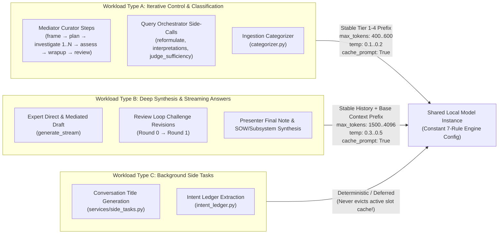

# QDR Query-Structuring & Two-Tier Workload Specification

> **Document ID:** `11-qdr-query-structuring-and-workload-specification`  
> **Target Repository:** [`D:\Work\Agents\iOCO-vodacom-qdr`](file:///D:/Work/Agents/iOCO-vodacom-qdr)  
> **QDR Spec Mirror:** [`D:\Work\Agents\iOCO-vodacom-qdr\docs\superpowers\specs\2026-11-06-qdr-query-structuring-and-two-tier-workload-design.md`](file:///D:/Work/Agents/iOCO-vodacom-qdr/docs/superpowers/specs/2026-11-06-qdr-query-structuring-and-two-tier-workload-design.md)  
> **Builds On:**  
> - [`2026-11-02-local-ai-prefill-and-moe-optimization-design.md`](file:///D:/Work/Agents/iOCO-vodacom-qdr/docs/superpowers/specs/2026-11-02-local-ai-prefill-and-moe-optimization-design.md)  
> - [`2026-11-03-local-ai-tuning-advisor-design.md`](file:///D:/Work/Agents/iOCO-vodacom-qdr/docs/superpowers/specs/2026-11-03-local-ai-tuning-advisor-design.md)  
> - [`10-two-tier-inference-gateway-and-workload-design.md`](file:///d:/Work/Agents/int-local-ai/docs/10-two-tier-inference-gateway-and-workload-design.md)  
> **Status:** Active Specification  
> **Date:** 2026-11-06  

---

## 1. Architectural Alignment: Two-Tier Separation Between `int-local-ai` and QDR

Following architectural review of how local model tuning interacts with QDR's diverse query types (and aligning directly with `2026-11-03-local-ai-tuning-advisor-design.md` §5 & §8), we enforce a clean **Two-Tier Separation of Concerns**:

1. **Tier 2 — Shared System-Level Invariants (`int-local-ai` Infrastructure Layer):**
   - Low-level runtime parameters (`--ubatch-size 2048`, `--batch-size 2048`, `--threads <P-Cores>`, `--cache-type-k q8_0`, `--cache-type-v q8_0`, `--ctx-checkpoints 32`, `--flash-attn on`) and OS-level process isolation (stopping competing `ollama` instances, inspecting `llama-server` flags, and tailing raw server log files on Linux/macOS/Windows) belong **exclusively** to the central `int-local-ai` gateway/daemon.
   - **Rule:** System-level engine flags are set **once** per loaded model to cater to the entire mix of workloads and are **never flipped per query** (because reloading a model flushes 100% of the KV prefix cache and stalls the server for 10–30+ seconds).
2. **Tier 1 — Application Query Structuring & Per-Call Knobs (`iOCO-vodacom-qdr`):**
   - QDR's sole responsibility for prefill optimization is **preserving a byte-identical static prefix across the majority (80%–95%+) of iterations** and adjusting **per-request payload parameters** (`max_tokens` budgets, `temperature`, `cache_prompt`, and `side_tasks` routing) per workload type.
   - QDR records per-call timings and workload telemetry (`local-call-record` / Tuning Advisor §4) via standard HTTP stream timing and server API responses without embedding OS-specific log tailers or process killers.

---

## 2. How QDR Handles Differing Query Workloads Without Engine Reconfiguration

QDR issues three distinct classes of local LLM traffic against the same loaded model instance:



### Why the Majority of Iterations Achieve Sub-Second Prefill
- **Cold Iteration (Step 1 of a Turn):** Ingests the initial `static_prefix + Question + history` (`~2,000–4,000 tokens`). With `--ubatch-size 2048` and P-core pinning at Tier 2, cold prefill completes in **~2.5–3.8 seconds**.
- **Warm Iterations (Steps 2..N of `investigate`, `assess`, `wrapup`, `review`, `present`, and follow-up turns):** Because Tiers 1–3 are frozen and Tier 4 (`known_evidence` + `observations`) is strictly append-only, the engine reuses **96%–99.4%** of the prompt from the KV cache / context checkpoints and evaluates only the newly appended `~30–150` delta tokens in **0.15–0.35 seconds**.

---

## 3. QDR Query-Structuring & Payload Checklist (`QDR-1` through `QDR-6`)

*(Note: Verify each item below against `feat/local-ai-prefill` and `local-call-record` worktrees to ensure complete coverage across all call sites.)*

### QDR-1: Chronological Append-Only `known_evidence()`
- **Files:**
  - [`apps/api/services/mediator/ledger_io.py:141-144`](file:///D:/Work/Agents/iOCO-vodacom-qdr/apps/api/services/mediator/ledger_io.py#L141-L144)
  - [`apps/api/services/mediator/runtime.py:230`](file:///D:/Work/Agents/iOCO-vodacom-qdr/apps/api/services/mediator/runtime.py#L230)
- **Invariant:** `known_evidence()` must return evidence items in chronological ascending order (`[E1, E2, ..., En]`) so that when `E(n+1)` is recorded during `investigate`, it is appended to the **end** of the `<evidence>` block rather than prepended to the top (which previously shifted all tokens down and invalidated 100% of the KV cache on every step).

```python
def known_evidence(db, conversation_id: int, limit: int = 30) -> list[EvidenceRef]:
    rows = (
        db.query(LedgerEvidence)
        .filter(LedgerEvidence.conversation_id == conversation_id)
        .order_by(LedgerEvidence.evidence_no.desc())
        .limit(limit)
        .all()
    )
    rows.reverse()
    return _mark_flagged(db, [_ref(row) for row in rows])
```

---

### QDR-2: Canonical 5-Tier Prefix Hierarchy in `curator_prompt_parts()`
- **Files:**
  - [`apps/api/services/mediator/prompts.py:225-277`](file:///D:/Work/Agents/iOCO-vodacom-qdr/apps/api/services/mediator/prompts.py#L225-L277)
  - [`apps/api/services/mediator/review.py:46`](file:///D:/Work/Agents/iOCO-vodacom-qdr/apps/api/services/mediator/review.py#L46)
  - [`apps/api/services/mediator/runtime.py:867`](file:///D:/Work/Agents/iOCO-vodacom-qdr/apps/api/services/mediator/runtime.py#L867)
- **Invariant:** Every Curator call within a turn must assemble its prompt sections in strict decreasing order of stability:
  1. **Tier 1 (Session-Static):** `ROLE_PREAMBLE` + `capabilities_text` *(Must also be passed to `_review()` and `_present_note()` instead of `""` so the prefix at token ~65 never changes)*.
  2. **Tier 2 (Turn-Invariant):** `Question` + `steering` + `history` + `references`.
  3. **Tier 3 (Fixed After Step 1):** `Your framing` (`frame`) — placed **above** `known_evidence`.
  4. **Tier 4 (Monotonically Append-Only Ledger):** `known_evidence` (`E1..En`) + `corrections` + `observations` (`step 1 .. step k`).
  5. **Tier 5 (Stage-Specific Ephemeral Tail):** `playbooks` (when `stage == "plan"` — placed **below** `observations` so its removal in `investigate` only affects the tail) + `human_answer` / `stop_reason` / `answer` + `STATE_INSTRUCTIONS[state]` + `ACTION_SCHEMAS[allowed]`.

---

### QDR-3: Stable History-First Ordering in `generate_stream()` (Workload Type B)
- **Files:**
  - [`apps/api/services/llm_provider.py:602`](file:///D:/Work/Agents/iOCO-vodacom-qdr/apps/api/services/llm_provider.py#L602)
  - [`apps/api/services/llm.py:330`](file:///D:/Work/Agents/iOCO-vodacom-qdr/apps/api/services/llm.py#L330)
- **Invariant:** Construct `user_content` with `history_text` **before** `context_section`:
  ```python
  user_content = f"{history_text}{context_section}\nUser Question: {user_message}"
  ```
  This preserves a byte-identical prefix across:
  1. Multi-turn conversations where `system_prompt + history_text` grows by appending prior turns.
  2. `review_loop` challenge revision rounds ([`review.py:152`](file:///D:/Work/Agents/iOCO-vodacom-qdr/apps/api/services/mediator/review.py#L152)), where `challenge_chunks` are appended to the end of `context_section` (`base + challenge_chunks`), keeping `system_prompt + history_text + base` 100% cached between Draft Round 0 and Challenge Round 1.

---

### QDR-4: Prefix Role Splitting & Stage-Specific Output Budgets (`generate_text()`)
- **Files:**
  - [`apps/api/services/llm_provider.py:1087-1100`](file:///D:/Work/Agents/iOCO-vodacom-qdr/apps/api/services/llm_provider.py#L1087-L1100)
  - [`apps/api/services/mediator/service.py`](file:///D:/Work/Agents/iOCO-vodacom-qdr/apps/api/services/mediator/service.py)
- **Invariants:**
  1. When `cacheable_prefix` is supplied to `generate_text()` on `lmstudio` or `openai`, place `cacheable_prefix` in the `system` role message and the remaining prompt in the `user` role message (instead of using a dummy `"You are a helpful assistant."` system message).
  2. Pass `extra_body={"cache_prompt": True, "chat_template_kwargs": {"enable_thinking": False}}` (so `llama-server` / `vllm-mlx` / compatible backends honor explicit slot caching and skip `<think>` generation on JSON control calls).
  3. Enforce stage-specific `max_tokens` budgets so intermediate steps cannot generate runaway multi-thousand-token responses:
     - **Curator Action (`_next_action`):** `max_tokens=600`, `temperature=0.2`
     - **Curator Review (`_review`):** `max_tokens=500`, `temperature=0.2`
     - **Orchestrator `query_assist`:** `max_tokens=400`, `temperature=0.1`
     - **Presenter Note (`_present_note`):** `max_tokens=1500`, `temperature=0.3`
     - **Expert Synthesis (`generate_stream`):** `max_tokens=4096`, `temperature=0.3–0.5`

---

### QDR-5: Protecting Active KV Slots from Side-Task Eviction (`side_tasks.py`)
- **Files:**
  - `apps/api/services/side_tasks.py`
  - `apps/api/services/intent_ledger.py`
- **Invariant:** On single-slot local servers (`--parallel 1`), firing an unrelated short prompt (such as a 572-token conversation-title generator) immediately after an answer overwrites the single KV slot and evicts the 4,000+ token conversation prefix!
  - Keep deterministic/non-LLM title generation as the default for local providers when `parallel == 1`, or defer background `intent_ledger` extraction until the conversation is idle (or route to a secondary slot when `--parallel >= 2` with `--ctx-checkpoints 32` is active).

---

### QDR-6: Suppressing `/v1/models` Polling During Active Generation & Batch Embeddings
- **Files:**
  - [`apps/api/services/llm_provider.py:440`](file:///D:/Work/Agents/iOCO-vodacom-qdr/apps/api/services/llm_provider.py#L440)
  - [`apps/api/services/lmstudio_probe.py`](file:///D:/Work/Agents/iOCO-vodacom-qdr/apps/api/services/lmstudio_probe.py)
- **Invariants:**
  1. Cache `/v1/models` discovery responses for 60 seconds and suppress background `/v1/models` probes while a local generation stream is in flight.
  2. Expose `LMSTUDIO_EMBED_BATCH_SIZE` (default `10` on Windows Vulkan, `64` on Mac Mini M4 Pro / Linux) in `apps/api/config.py`.

---

## 4. How Future Query-Layer Adjustments Will Be Managed

1. **Ownership:** All future changes to QDR prompt templates, query profiles (`2026-11-03-local-ai-tuning-advisor-design.md` §5.1), and per-call output budgets are developed, tested, and committed **inside the QDR repository (`D:\Work\Agents\iOCO-vodacom-qdr`)**.
2. **Cross-Project Contract:** The only rule QDR must preserve when adding new features or query profiles is **Prefix Invariance**: any new per-query context or profile instruction must be placed in **Tier 5 (the ephemeral tail)**, never injected into Tiers 1–3.
3. **Observability Feedback Loop:** Both QDR's `local-call-record` table and the central `int-local-ai` gateway telemetry monitor track prefix cache hit rates and prefill times. If a future QDR prompt change causes cache hit rates on follow-up turns to drop below `80%–85%`, the regression is immediately flagged for adjustment in QDR's prompt builder.

