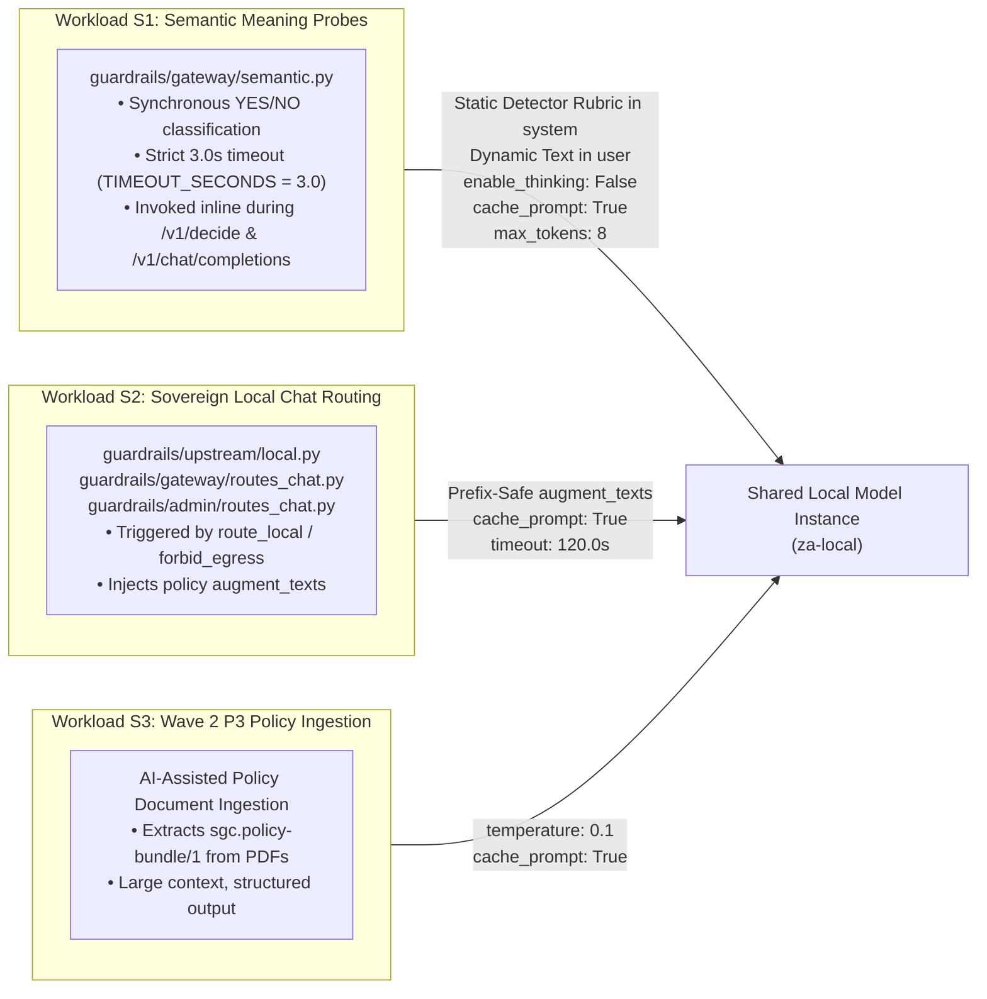

# SGC Local-AI Prefill Optimization & Query-Structuring Specification

> **Document ID:** `12-sgc-query-structuring-and-workload-specification`  
> **Target Repository:** [`D:\Work\Agents\int-standards-guardrails-compliance`](file:///D:/Work/Agents/int-standards-guardrails-compliance)  
> **SGC Spec Mirror:** [`D:\Work\Agents\int-standards-guardrails-compliance\docs\superpowers\specs\2026-11-06-sgc-local-ai-prefill-and-query-structuring-design.md`](file:///D:/Work/Agents/int-standards-guardrails-compliance/docs/superpowers/specs/2026-11-06-sgc-local-ai-prefill-and-query-structuring-design.md)  
> **Builds On:**  
> - [`2026-10-26-cost-routing-and-meaning-classifier-design.md`](file:///D:/Work/Agents/int-standards-guardrails-compliance/docs/superpowers/specs/2026-10-26-cost-routing-and-meaning-classifier-design.md)  
> - [`10-two-tier-inference-gateway-and-workload-design.md`](file:///d:/Work/Agents/int-local-ai/docs/10-two-tier-inference-gateway-and-workload-design.md)  
> **Status:** Active Specification  
> **Date:** 2026-11-06  

---

## 1. Architectural Boundary Between `int-local-ai` and SGC

Under the Two-Tier Local Inference Architecture ([`10-two-tier-inference-gateway-and-workload-design.md`](file:///d:/Work/Agents/int-local-ai/docs/10-two-tier-inference-gateway-and-workload-design.md)):

1. **Tier 2 — Shared System-Level Invariants (`int-local-ai` Infrastructure Layer):**
   - Low-level C++/GPU engine parameters (`--ubatch-size 2048`, `--batch-size 2048`, `--threads <P-Cores>`, `--cache-type-k q8_0`, `--cache-type-v q8_0`, `--ctx-checkpoints 32`), OS process isolation, and real-time server log tailing (`R1–R7`) are managed centrally by `int-local-ai`.
   - SGC never manages local LLM processes, thread affinity, or engine reloads.
2. **Tier 1 — SGC Query Structuring & Payload Controls (`int-standards-guardrails-compliance`):**
   - SGC's responsibility is to structure its outbound requests to the site's `local_route` (`za-local`) so that **80%–95%+ of calls reuse the KV prefix cache** (achieving sub-second prefill) and pass appropriate per-request sampling/thinking parameters.

---

## 2. SGC's Three Local LLM Workloads

Inspecting SGC's codebase reveals three distinct workloads that target the site's in-country `local_route` (`za-local`):



---

## 3. Detailed SGC Modifications (`SGC-1` through `SGC-3`)

### 3.1 Modification SGC-1: Prefix-Cached, Non-Thinking Semantic Detector Probes (`guardrails/gateway/semantic.py`)

- **Target File:** [`guardrails/gateway/semantic.py`](file:///D:/Work/Agents/int-standards-guardrails-compliance/guardrails/gateway/semantic.py#L24-L76)

#### Two Critical Defects Identified in Current Code
1. **Silent Failure / Timeout with Hybrid Reasoning Models (`max_tokens: 3` + `<think>`):**
   In [`semantic.py:60-62`](file:///D:/Work/Agents/int-standards-guardrails-compliance/guardrails/gateway/semantic.py#L60-L62), `_ask()` sends:
   ```python
   payload = {"model": model, "temperature": 0, "max_tokens": 3,
              "messages": [{"role": "system", "content": SYSTEM_PROMPT}, {"role": "user", "content": prompt}]}
   ```
   When the local model is a hybrid reasoning model (`Qwen3.6-35B-A3B` or `Qwen3`), it defaults to emitting `<think>\n` as its first 2 tokens. With `"max_tokens": 3`, token generation terminates **inside the `<think>` header before `YES` or `NO` is ever emitted**!
   Line 76 (`str(answer).strip().upper().startswith("YES")`) then evaluates `"<THINK>"` as `False`—silently turning every true positive into a false negative, or timing out at `3.0s` (`SemanticUnavailable` $\rightarrow$ fail-closed `DENY`).
2. **Bundling Static Detector Rules Inside the Dynamic User Message:**
   Currently, `_prompt(config, text)` ([`semantic.py:49-57`](file:///D:/Work/Agents/int-standards-guardrails-compliance/guardrails/gateway/semantic.py#L49-L57)) concatenates `Question`, up to 6 `Example answered YES/NO` blocks (`<= 3,000` chars), and `Text: <<<{text}>>>` into a single `user` string.
   Because `Question` and the few-shot examples are **100% static per detector across all calls in a policy snapshot**, placing them in the `system` message (alongside `SYSTEM_PROMPT`) and keeping only `Text: <<<{text}>>>\nAnswer YES or NO.` in the `user` message guarantees a **100% KV prefix cache hit** on the detector definition for every subsequent request—cutting semantic check latency to **< 150 ms**.

#### Drop-In Implementation (`guardrails/gateway/semantic.py:49-76`)
```python
def _detector_prefix(config: dict) -> str:
    """Static per-detector rubric and few-shot examples (100% cacheable across calls)."""
    lines = [
        SYSTEM_PROMPT,
        f"Question: {config.get('question', '').strip()}",
    ]
    for label, key in (("YES", "examples_yes"), ("NO", "examples_no")):
        for example in (config.get(key) or [])[:3]:
            lines.append(f"Example answered {label}: <<<{str(example)[:500]}>>>")
    return "\n".join(lines)


def _user_text_block(config: dict, text: str) -> str:
    """Dynamic per-request text suffix placed at the very end of the prompt."""
    max_chars = int(config.get("max_chars") or DEFAULT_MAX_CHARS)
    return f"Text: <<<{text[:max_chars]}>>>\nAnswer YES or NO."


def _ask(base_url: str, model: str, system_prefix: str, user_prompt: str) -> bool:
    payload = {
        "model": model,
        "temperature": 0,
        "max_tokens": 8,
        "cache_prompt": True,
        "chat_template_kwargs": {"enable_thinking": False},
        "messages": [
            {"role": "system", "content": system_prefix},
            {"role": "user", "content": user_prompt},
        ],
    }
    client = (
        httpx.Client(timeout=TIMEOUT_SECONDS, transport=_transport)
        if _transport
        else httpx.Client(timeout=TIMEOUT_SECONDS)
    )
    try:
        with client:
            resp = client.post(f"{base_url.rstrip('/')}/v1/chat/completions", json=payload)
    except httpx.HTTPError as exc:
        raise SemanticUnavailable(f"local model unreachable: {type(exc).__name__}")
    if resp.status_code != 200:
        raise SemanticUnavailable(f"local model returned {resp.status_code}")
    try:
        answer = resp.json()["choices"][0]["message"]["content"]
    except (ValueError, KeyError, IndexError, TypeError):
        raise SemanticUnavailable("local model gave no answer")
    raw = str(answer)
    # If the model ignored enable_thinking=False and truncated inside an unclosed <think> block,
    # treat as uncertain (SemanticUnavailable) so the site's fail-closed policy decides.
    if "<think>" in raw.lower() and "</think>" not in raw.lower():
        raise SemanticUnavailable("local model truncated inside <think> block")
    cleaned = raw.split("</think>")[-1].strip().upper()
    return cleaned.startswith("YES")
```
*(In `make_checker` at line 94, update `_ask(base_url, model, _prompt(spec.config or {}, text))` to `_ask(base_url, model, _detector_prefix(spec.config or {}), _user_text_block(spec.config or {}, text))`.)*

---

### 3.2 Modification SGC-2: Prefix-Safe Placement of Policy `augment_texts` in Multi-Turn Chat

- **Target Files:**
  - [`guardrails/gateway/routes_chat.py:81-83`](file:///D:/Work/Agents/int-standards-guardrails-compliance/guardrails/gateway/routes_chat.py#L81-L83)
  - [`guardrails/admin/routes_chat.py:178-180`](file:///D:/Work/Agents/int-standards-guardrails-compliance/guardrails/admin/routes_chat.py#L178-L180)

#### Why Current `augment_texts` Prepending Busts the Multi-Turn Prefix Cache
Both `gateway/routes_chat.py:81-83` and `admin/routes_chat.py:178-180` currently build `upstream_messages` by prepending `augment_texts` at **index `0`** (before `input_outcome.messages`):
```python
upstream_messages = (
    [{"role": "system", "content": t} for t in input_decision.augment_texts] + input_outcome.messages
)
```
In a multi-turn conversation:
- Suppose Turns 1 and 2 have no `AUGMENT` hits (`augment_texts == []`). The local model caches `[caller_system_prompt, user_1, assistant_1, user_2, assistant_2]` (`~4,500` tokens).
- On Turn 3, the user's message triggers an `AUGMENT` requirement (`augment_texts == ["Policy reminder: ..."]`).
- Because `augment_texts` is inserted at **index `0`**, every single token of `caller_system_prompt` and Turns 1–2 is shifted down, **invalidating 100% of the 4,500 cached tokens** and forcing a full cold prefill!

#### Drop-In Fix: Inject `augment_texts` Immediately Before the Final User Message on the Local Route Only
By placing `augment_texts` right before `messages[-1]` **when `route.kind == "local"`** (while keeping offshore OpenRouter/Anthropic routes unchanged with `augment_texts` first), `messages[:-1]` (the caller's initial `system` prompt and all prior conversation turns) stays **100% byte-identical at the start of the prompt** on the local model, preserving the entire multi-turn KV cache without risking offshore template errors.
*(Verified against the GGUF `tokenizer.chat_template` of both `Qwen3` and `Gemma-4`: both templates explicitly render `role == "system"` mid-conversation inside `loop_messages`.)*

Add `build_upstream_messages()` to [`guardrails/gateway/conversation.py`](file:///D:/Work/Agents/int-standards-guardrails-compliance/guardrails/gateway/conversation.py) (and call it from both `gateway/routes_chat.py` and `admin/routes_chat.py`):
```python
def build_upstream_messages(
    messages: list[dict],
    augment_texts: tuple[str, ...] | list[str],
    *,
    route_kind: str = "openrouter",
) -> list[dict]:
    """On the local route, place policy augment_texts immediately before the final message
    so that the caller's static system prompt and historical turns (messages[:-1]) remain
    100% prefix-identical in the local KV cache. Offshore routes keep augment_texts first."""
    if not augment_texts:
        return list(messages)
    aug_msgs = [{"role": "system", "content": t} for t in augment_texts]
    if route_kind != "local" or len(messages) <= 1:
        return aug_msgs + list(messages)
    return list(messages[:-1]) + aug_msgs + [messages[-1]]
```

---

### 3.3 Modification SGC-3: Local Upstream Payload Hints & Per-Site Timeout (`guardrails/upstream/local.py`)

- **Target File:** [`guardrails/upstream/local.py`](file:///D:/Work/Agents/int-standards-guardrails-compliance/guardrails/upstream/local.py#L12-L21)
- **Why This Matters:**
  1. `timeout: float = 30.0` is too short when a large multi-thousand-token coding prompt is diverted to `za-local` via `route_local` or `forbid_egress`, causing false `504 upstream_timeout` errors. Add `timeout_seconds` to the site's `local_route` setting (defaulting to `120.0`), consistent with SGC's per-site configuration model.
  2. Explicitly passing `"cache_prompt": True` ensures `llama-server` / LM Studio / `vllm-mlx` reuses KV prefix slots across turns.

#### Drop-In Implementation (`guardrails/upstream/local.py`)
```python
from __future__ import annotations

import httpx

from guardrails.upstream.base import ChatCompletionResult, post_chat_completion

DEFAULT_LOCAL_TIMEOUT = 120.0


async def chat_completion(
    client: httpx.AsyncClient,
    base_url: str,
    model: str,
    messages: list[dict],
    timeout: float = DEFAULT_LOCAL_TIMEOUT,
) -> ChatCompletionResult:
    url = f"{base_url.rstrip('/')}/v1/chat/completions"
    payload = {
        "model": model,
        "messages": messages,
        "cache_prompt": True,
    }
    return await post_chat_completion(client, url, headers={}, payload=payload, timeout=timeout)
```

---

## 4. Verification Plan & Future Adjustments

### 4.1 Unit Tests to Add in SGC (`tests/`)
1. **`test_semantic_disables_thinking_and_splits_prefix`:**
   - Assert `_ask()` sends `messages[0]["role"] == "system"` containing `SYSTEM_PROMPT + Question + examples`, `messages[1]["role"] == "user"` containing only `Text: <<<...>>>\nAnswer YES or NO.`, `cache_prompt is True`, `chat_template_kwargs == {"enable_thinking": False}`, and `max_tokens >= 8`.
   - Assert that if a mock model returns `"<think>\n</think>\nYES"`, `_ask()` still parses `"YES"` as `True`.
2. **`test_build_upstream_messages_preserves_history_prefix`:**
   - Given a 4-message conversation `[sys, u1, a1, u2]` and `augment_texts = ["policy A"]`, assert `build_upstream_messages()` returns `[sys, u1, a1, {"role": "system", "content": "policy A"}, u2]` so indices `0..2` remain unchanged.

### 4.2 How Future Adjustments Will Be Managed
- All code changes to SGC's query builders (`semantic.py`, `conversation.py`, `local.py`, and Wave 2 P3 document ingestion) are implemented and unit-tested **inside the SGC repository (`D:\Work\Agents\int-standards-guardrails-compliance`)**.
- Whenever new LLM-backed detectors or ingestion pipelines are added to SGC, they follow the **Two-Tier Contract**: static instructions/schemas/examples in the `system` prefix, dynamic document/query text in the `user` suffix, and `cache_prompt: True`.

