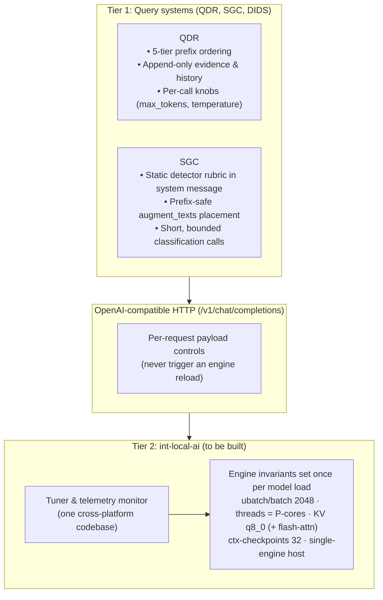

# Handover Summary: Local Model Prefill Optimization & Two-Tier Architecture (`int-local-ai`, `QDR`, `SGC`)

> **Document ID:** `13-handover-local-model-optimization-and-two-tier-architecture`  
> **Date:** 2026-11-06 (revised after a source-level quality check on the same day)  
> **Canonical copy:** this file. [`HANDOVER.md`](../HANDOVER.md) at the repo root is only a pointer.  
> **Primary Repository:** `D:\Work\Agents\int-local-ai` (`branch: dev-v1.2`)  
> **Connected Application Repositories:**  
> - **QDR:** `D:\Work\Agents\iOCO-vodacom-qdr` (checked against `dev-v3.14`, commit `afbf7e9`)  
> - **SGC:** `D:\Work\Agents\int-standards-guardrails-compliance` (checked against `dev-v1.11`, commit `20bd99b`)  
> - **DIDS:** `D:\Work\Agents\iOCO-vodacom-dids-work`  
> **Target Hardware:** Windows staging (`ASUS ExpertBook`, 64 GB), production appliance (**Apple Mac mini M5 Pro**, 64 GB unified memory, 307 GB/s, LM Studio **MLX** engine, `qwen/qwen3.6-35b-a3b` 8-bit), Linux test servers (`x86_64` / `ARM64`)
> **Mac server details, endpoints and open items:** see [`10`](10-two-tier-inference-gateway-and-workload-design.md) §6. **Important:** the llama.cpp rules in §3 (ubatch, threads, KV `q8_0`, flash-attn, `--ctx-checkpoints`, `cache_prompt`) do not apply to the MLX host; this document's §3–§5 still need revising around engine profiles (see doc 14).

> **How to read the status labels in this document**
> - **Done** – verified present in the application's source on the commit named above.
> - **Pending** – verified *not* present in source; the spec is still to be implemented.
> - **Unverified** – stated by an earlier session or spec; no source, log or measurement was found to confirm it.

---

## 1. Executive Summary & The Core Objective

### 1.1 The Problem
When running local LLMs (especially sparse MoE models such as `Qwen3.6-35B-A3B` and `Qwen3-Coder-30B-A3B`), decode is fast but **prompt evaluation (prefill / time-to-first-token)** dominates latency whenever the prompt is recomputed from scratch. In multi-step agent loops (QDR's 5–9 step Mediated Conversation) recomputing 4,000–12,000 prompt tokens per step caused **30–60+ second stalls**. *(The "85–95% of delay" share is Unverified.)*

### 1.2 The Goal
Make follow-up steps and turns begin generating quickly (target: **well under 1 s of prefill**) on the large majority (80–95%+) of iterations, with **one maintainable tuning codebase** across Windows, macOS and Linux and no engine code duplicated in application repositories.

### 1.3 Benchmark Evidence (Unverified – read before relying on it)

The figures below come from an earlier live 6-turn session (log reported as `2026-11-02.2.log`, **not found in any repository**) on `qwen3-coder-30b-a3b-instruct_pruned_reap-15b-a3b` (`Q4_K_M`, ~15B total / ~3B active MoE):

- **Vulkan offload regression:** LM Studio runtime `2.60.0` reportedly fell back to CPU (~1.7 GB RAM); `vulkan-avx2@2.57.0` restored ~9.17 GB GPU offload.
- **Prefix reuse:** Turn 6 reportedly reused **3,702 of 3,724 prompt tokens (99.4%)** and evaluated **22 new tokens** with `--parallel 1` and `--ctx-checkpoints 32`.
- **KV cache type:** decode reportedly fell from 5.71 to 3.02 tok/s at 6,659 tokens with an `f16` V-cache; locking K and V to `q8_0` was the fix. Cause and effect were not isolated by a controlled run. `q8_0` V-cache also requires flash attention in llama.cpp (`--flash-attn on`).
- **Host contention / batching:** competing `ollama.exe` stopped; `--ubatch-size` 512 → 2048; `--threads` 5 → 8.

**Known inconsistencies – do not quote these numbers externally until re-measured:**

| Issue | Detail |
| :--- | :--- |
| Same benchmark, different numbers | Doc 09 §2 reports context growth 4,120 → 11,480 tokens, KV 12.8 → 6.4 GB, Turn 1 42.10 s → 3.81 s. This document's source session reported 609 → 6,659 tokens. |
| Timing vs. token count | An earlier draft attributed 3.81 s to evaluating 22 delta tokens (~6 tok/s). That would breach doc 09's own Alert R2 (< 50 tok/s) and contradicts the sub-second goal and doc 09's 0.18–0.32 s warm turns. The 3.81 s most likely belongs to a different measurement (cold turn or decode). It is therefore **not stated here as a delta-prefill time**. |
| Token accounting | 3,724 prompt tokens vs. a 6,659-token context is not reconciled (generated tokens may explain it). |
| Active parameters | Doc 09 says "15B active"; the correct figure is ~3B active (15B total after pruning). |

**Action:** re-run the 6-turn benchmark once with the `local_ai_tuner` monitor (Step 1 below), keep the raw log in this repo, and make docs 09 and 13 quote the same run.

---

## 2. Architecture: Two-Tier Separation

QDR, SGC and Linux test environments share one local model. Embedding engine tuning inside QDR ([`08`](08-qdr-telemetry-monitoring-and-autotuning-design.md)) was rejected because it (1) duplicates tuning code per application and (2) invites per-application engine reloads, which **flush the whole in-memory KV cache** and stall every caller for ~10–30 s *(duration Unverified)*.

- **Tier 2** owns engine/host settings and telemetry. It sets them once; any remediation that needs a reload runs only when all slots are idle.
- **Tier 1** never touches processes, threads or engine config. It keeps the static prefix byte-stable and varies only request-payload fields.
- **Server-type caveat:** payload hints are not honoured equally everywhere. QDR measured (2026-11-03, `call_tuning.py`) that **LM Studio reuses the prefix without `cache_prompt` and ignores `chat_template_kwargs.enable_thinking`**. `llama-server` and some other backends do honour them. Tier 1 code must therefore apply those two hints **per server type**, not unconditionally.
- LM Studio is configured through its UI / `lms` CLI, not llama-server flags. "Emit launch flags" in the CLI applies to `llama-server`; for LM Studio the tuner should emit a settings checklist and verify what the server reports.

---

## 3. Component 1: Tier 2 in `int-local-ai` – **Pending (nothing built)**

`src/local_ai_tuner/` does **not exist yet**. The four modules below exist only as reference snippets in [`09`](09-generic-prefill-optimization-and-autotuning-framework.md). Specs: [`09`](09-generic-prefill-optimization-and-autotuning-framework.md), [`10`](10-two-tier-inference-gateway-and-workload-design.md).

### 3.1 The seven rules – and who owns each

"Rule N" below is a design rule. Doc 09's remediation codes (`R1`–`R7`) are a **different numbering** (e.g. Rule 2 is batch size; Alert R2 is low ingestion speed). In prose use "Rule N" for rules and "Alert Rn" for codes.

| Rule | Statement | Owner |
| :--- | :--- | :--- |
| 1 | Deterministic prefix: static instructions/schemas/rubrics at tokens `0..K`, no timestamps or shifting blocks | **Tier 1** (Tier 2 only validates and alerts) |
| 2 | `--ubatch-size 2048` and `--batch-size 2048` | Tier 2 |
| 3 | `--threads` = physical **performance** cores (not SMT, not E-cores) | Tier 2 |
| 4 | `--cache-type-k q8_0` and `--cache-type-v q8_0` (needs flash attention) | Tier 2 |
| 5 | Zero host contention: one inference engine active (stop background `ollama` etc.) | Tier 2 |
| 6 | Warm follow-up turns reuse ≥ 85% of prompt tokens (`--ctx-checkpoints 32`) | Tier 2 monitors; Tier 1 causes failures |
| 7 | Closed-loop telemetry watchdog; remediation only when all slots are idle | Tier 2 |

### 3.2 Planned package (`src/local_ai_tuner/`)
- `platform_adapter.py` – hardware inspector (P-cores via `/proc/cpuinfo` + `lscpu` on Linux, `sysctl hw.perflevel0.physicalcpu` on macOS, WMI/CIM on Windows) and conflicting-process audit.
- `prompt_engine.py` – reference deterministic prefix builder/validator.
- `telemetry_autotuner.py` – log parser (`prompt eval time`, cache-hit) and alert detector.
- `cli.py` – host readiness check, launch-flag/settings emitter, live telemetry watcher.

**Fix these defects from the doc 09 reference code before copying it:**
1. Windows: `Win32_Processor.NumberOfCores` counts E-cores as well; it is not a P-core count.
2. Linux: counting unique `core id` values undercounts multi-socket machines (ids repeat per socket) and does not separate P from E cores.
3. Cache-hit parser: an integer match (`prefix-match hit count`) is treated as a percentage.
4. Runbook: `pkill -9` should be SIGTERM-first (as Alert R4 says), and `--host 0.0.0.0` should be `127.0.0.1` unless remote access is required (this repo supports a compliance product).

---

## 4. Component 2: QDR (`D:\Work\Agents\iOCO-vodacom-qdr`)

**Spec in QDR:** `docs/superpowers/specs/2026-11-06-qdr-query-structuring-and-two-tier-workload-design.md` (untracked in QDR at time of writing). **Mirror here:** [`11`](11-qdr-query-structuring-and-workload-specification.md) (differs only in header lines).

Most of the query-layer work **has already been merged** into QDR (`afbf7e9`, "Merge local-ai-prefill …"). The old branch name `feat/local-ai-prefill` is no longer current work; the live worktree is `feat/local-call-record`. QDR's job here is **verification, not re-implementation**.

### 4.1 Workloads (QDR never changes server flags)
- **Type A – fast control/side calls:** Curator steps (`frame → plan → investigate 1..N → assess → wrapup → review`), `query_orchestrator`, `categorizer`. Low temperature, small output budgets.
- **Type B – deep synthesis/streaming:** Expert `generate_stream()`, review-loop revisions, `_present_note()`, subsystem synthesis. Higher temperature, larger budgets.
- **Type C – background side tasks:** title generation is deterministic (no model call) on local providers so a short prompt never overwrites the active slot's cached conversation.

### 4.2 Status of QDR-1 … QDR-6 (line numbers checked against `afbf7e9`)

| ID | Intent | Status | Where it is in source / what remains |
| :--- | :--- | :--- | :--- |
| **QDR-1** | `known_evidence()` returns oldest-first so new evidence appends at the end | **Done** | `services/mediator/ledger_io.py:141-147` |
| **QDR-2** | 5-tier prefix order: frame above evidence; playbooks after observations; `capabilities_text` passed to review/present | **Done** | `services/mediator/prompts.py:225-279`; `review.py:47`; `runtime.py:875-880` (`_present_note`). Remaining: add a test that asserts byte-identical Tiers 1–3 across all stages. |
| **QDR-3** | History before context in `generate_stream()` | **Done** | `services/llm_provider.py:728`. (`llm.py:330` is the guardrails-provider path, not the stream builder.) |
| **QDR-4** | Prefix in `system` role; per-stage output budgets; no wasted `<think>` | **Partly done, deliberately different** | `services/call_tuning.py` + `llm_provider.py:1329-1333` implement prefix-as-system and `budget_key` budgets (`review`, `present`, …). Budget *values* (600/500/1500) are **Unverified** against `local_ai.py`. For `lmstudio`, `cache_prompt` and `enable_thinking` are **intentionally not sent** (measured as ineffective); Ollama uses `think=False`. Do **not** re-add them for LM Studio. Add them only for a verified `llama-server`/`vllm-mlx` host type. |
| **QDR-5** | Protect the active KV slot from side-task eviction | **Partly done** | Deterministic titles: `services/side_tasks.py` (`derive_title`). **Deferring `intent_ledger` extraction while a turn is active: not found** in `intent_ledger.py` – **Pending** (or confirm it is handled elsewhere). |
| **QDR-6** | Quiet `/v1/models` polling; configurable embed batch size | **Partly done** | Probe cache (60 s, suppressed during local generation): `services/lmstudio_probe.py:18-54`. Embed batch size is a **per-host `embed_batch_size`** (`services/local_ai.py:42`, default 10), **not** an env var named `LMSTUDIO_EMBED_BATCH_SIZE` (that name does not exist). Platform-specific defaults (64 on Mac/Linux) and the "5–6×" speed-up are **Unverified**. |

---

## 5. Component 3: SGC (`D:\Work\Agents\int-standards-guardrails-compliance`)

**Spec in SGC:** `docs/superpowers/specs/2026-11-06-sgc-local-ai-prefill-and-query-structuring-design.md`. **Mirror here:** [`12`](12-sgc-query-structuring-and-workload-specification.md) (differs only in header lines; currently has unstaged edits).

All three items are **Pending**: the current SGC source matches the "before" state described in the spec, and the line numbers below are accurate.

| ID | Target (SGC) | Change | Notes / caveats |
| :--- | :--- | :--- | :--- |
| **SGC-1** | `guardrails/gateway/semantic.py:49-76` | Move the static rubric (`SYSTEM_PROMPT` + `Question` + examples) into the `system` message; keep only `Text: <<<…>>>\nAnswer YES or NO.` in `user`; raise `max_tokens` 3 → 8 | The prefix split is safe on any server and is the real cache win. `cache_prompt` and `enable_thinking: False` are **honoured only by some backends** (not LM Studio, per QDR's measurement). On LM Studio a reasoning model can still spend the 8 tokens inside a think block; the spec's defensive handling (treat an unclosed `<think>` as `SemanticUnavailable`, so the site's fail-closed policy decides) is what protects correctness. Reasoning may also come back in a separate field rather than `content`. The "< 150 ms warm probe" figure is **Unverified**; measure it. |
| **SGC-2** | `gateway/routes_chat.py:81-83`, `admin/routes_chat.py:178-180`, `gateway/conversation.py` | Add `build_upstream_messages(messages, augment_texts, route_kind=…)`. **On the local route only**, place `augment_texts` immediately before the final message so `messages[:-1]` stays byte-identical; **offshore routes keep `augment_texts` first** | Doc 12's claim that Qwen3 and Gemma-4 chat templates accept a mid-conversation `system` message is **Unverified** here; some Gemma templates reject or fold it. Test against the actual loaded model's template before shipping. |
| **SGC-3** | `guardrails/upstream/local.py:12-21` | Add `"cache_prompt": True` (same server-type caveat as SGC-1); raise default timeout 30 s → 120 s | Doc 12 proposes a `timeout_seconds` field on the site's `local_route` setting. **No environment variable is specified** (an earlier draft of this document invented `GUARDRAILS_LOCAL_UPSTREAM_TIMEOUT_SECONDS`; it does not exist). |

---

## 6. Document Map

| File | Purpose |
| :--- | :--- |
| [`../HANDOVER.md`](../HANDOVER.md) | Pointer to this document |
| [`09-generic-prefill-optimization-and-autotuning-framework.md`](09-generic-prefill-optimization-and-autotuning-framework.md) | Rules, alert codes, reference Python, Linux runbook (see §3.2 for known defects) |
| [`10-two-tier-inference-gateway-and-workload-design.md`](10-two-tier-inference-gateway-and-workload-design.md) | Two-tier design (note: its diagram says "R2–R7" while its text says "R1–R7"; its table lists SGC `max_tokens` as 3, superseded by 8) |
| [`11-qdr-query-structuring-and-workload-specification.md`](11-qdr-query-structuring-and-workload-specification.md) | QDR spec (mirror) – line numbers in it are stale; use §4.2 above |
| [`12-sgc-query-structuring-and-workload-specification.md`](12-sgc-query-structuring-and-workload-specification.md) | SGC spec (mirror) |

---

## 7. Implementation Order

1. **Docs housekeeping (`int-local-ai`, `dev-v1.2`):** after review, commit `07`–`13` + `HANDOVER.md`. Reconcile docs 09/10/11 with the corrections in this document (benchmark figures, line numbers, `max_tokens`, rule vs. alert naming).
2. **Re-measure:** run the 6-turn benchmark with raw logs saved in this repo; settle the numbers in §1.3.
3. **SGC:** implement SGC-1 … SGC-3 per doc 12 with its two unit tests, and add a server-type switch for `cache_prompt` / `enable_thinking`. Run SGC's `pytest`.
4. **QDR verification:** hand the QDR spec to the QDR agent to (a) confirm QDR-1…3 with tests, (b) close the QDR-5 ledger-deferral gap, (c) resolve the QDR-6 batch-size naming, (d) decide whether any non-LM-Studio host type should receive `cache_prompt` / `enable_thinking`.
5. **Build `src/local_ai_tuner/`** (with the §3.2 fixes) for Windows, macOS and Linux; unit-test it.
6. **Live multi-turn verification:** run the tuner's monitor during QDR and SGC multi-turn traffic (and on the Linux harness) to confirm ≥ 85% warm hit rate and sub-second prefill. Stop background `ollama` first (Rule 5).
